<div align="center">


<picture>
  <source media="(prefers-color-scheme: dark)" srcset="assets/icons/wordmark-dark.svg" />
  
</picture>

<p><strong>DISCOVER · CONNECT · CREATE</strong></p>
<p>Media discovery and community, built for Discord.</p>

<p>
  <a href="docs/README.md">DOCS</a>
  &nbsp;·&nbsp;
  <a href="docs/ARCHITECTURE.md">ARCHITECTURE</a>
  &nbsp;·&nbsp;
  <a href="CONTRIBUTING.md">CONTRIBUTE</a>
  &nbsp;·&nbsp;
  <a href="SECURITY.md">SECURITY</a>
</p>

[](https://github.com/Kyerstorm/Lemegeton/actions/workflows/ci-bot.yml)
[](https://nodejs.org/)
[](https://discord.js.org/)
[](https://www.postgresql.org/)
[](docs/LICENSE)

</div>

---

## A MEDIA UNIVERSE, INSIDE DISCORD

Find the next thing your community will love—and the connections that make it even better. Lemegeton brings anime, manga, novels, books, webnovels, films, series and games into Discord, with cross-provider discovery, source-backed relationships, shared archives, daily activities, rankings, sessions and games.

**For server owners:** Give members one place to discover, contribute and take part.
**For developers:** Explore a multi-guild TypeScript/discord.js system backed by PostgreSQL, with dedicated provider integrations, automated tests and an optional Next.js + Rust dashboard.

## COMMANDS

| Command | Opens |
|:--|:--|
| `/discover` | Media search, browse, compare, and recommendations |
| `/archive` | Community collections, submissions, and curation |
| `/community` | Daily activities, rankings, sessions, and events |
| `/play` | Group quizzes and media games |
| `/profile` | Profiles, provider links, and privacy controls |
| `/custom-role` | Member Custom Roles and management |
| `/settings` | Guild configuration |
| `/music` | Artist releases and guild notifications |

`/language` completes server setup alongside the guild's data-retention choice. `/help`, `/privacy`, and `/feedback` remain standalone.

## SYSTEM MAP

<p align="center">
  
</p>

## INTEGRATIONS

**Media:** AniList · Kitsu · MangaDex · TMDB · IGDB · Steam · Google Books · Open Library · Crossref · Royal Road

**Optional:** Spotify · YouTube Data API · SoundCloud · S3-compatible media storage

Provider coverage, credentials, and returned fields vary by source. Recommendations, provider-declared relationships, local matches, and community-approved links remain separate evidence types.

## QUICK START

**Requirements:** Node.js 22.9+, npm, PostgreSQL, and a Discord application.

```bash
git clone https://github.com/Kyerstorm/Lemegeton.git
cd Lemegeton
npm install --no-audit --no-fund
cp .env.example .env
```

Configure the bot token and PostgreSQL connection in `.env`.

```bash
npm run typecheck
npm test
npm start
```

Register commands with `npm run deploy:commands`. The optional dashboard requires its own Next.js and Rust build; see [deployment](docs/DASHBOARD.md).

## DOCUMENTATION

| Guide | |
|:--|:--|
| [Architecture](docs/ARCHITECTURE.md) | Runtime, services, data flow, and guild boundaries |
| [Dashboard](docs/DASHBOARD.md) | Next.js, Rust/Axum, OAuth, and bridge |
| [Media discovery](docs/MEDIA_DISCOVERY.md) | Providers, relationships, and provenance |
| [Custom Roles](docs/CUSTOM_ROLES_SPEC.md) | Role lifecycle and configuration |
| [CI and verification](docs/CI.md) | Automated checks and live acceptance |
| [Security policy](SECURITY.md) | Vulnerability reporting |
| [Security review](docs/SECURITY_AUDIT.md) | Controls and residual risks |
| [Backups](docs/DATA_BACKUPS.md) | Recovery and verification |
| [Privacy](docs/PRIVACY_POLICY.md) | Data handling and retention |
| [Community guidelines](docs/COMMUNITY_GUIDELINES.md) | Submissions and moderation |
| [Contributing](CONTRIBUTING.md) | Development standards |
| [Terms](docs/TERMS_OF_SERVICE.md) · [License](docs/LICENSE) | |

## STATS

<p align="center">
  <a href="https://github.com/Kyerstorm/Lemegeton"></a>
  <a href="https://github.com/Kyerstorm/Lemegeton/forks"></a>
  <a href="https://github.com/Kyerstorm/Lemegeton/graphs/contributors"></a>
  
  
</p>

<!-- REPO-STATS:START -->
| Tracked files | Lines of code | Text characters |
|--:|--:|--:|
| 269 | 45,950 | 3,197,119 |

<sub>Tracked files after generated/cache exclusions · non-blank lines across source files · characters across tracked text files, excluding line breaks · refreshed 2026-11-20 15:52 UTC.</sub>
<!-- REPO-STATS:END -->

<div align="center">
  <sub>LEMEGETON / V3</sub>
</div>
