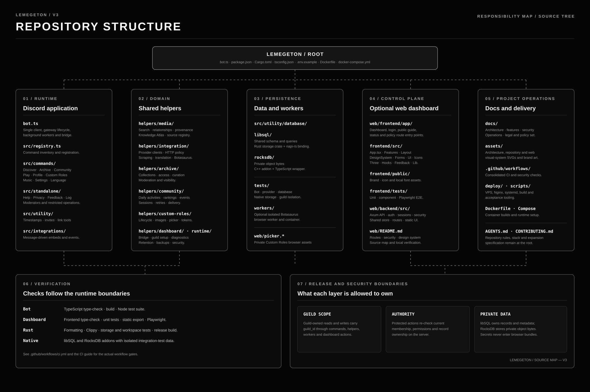
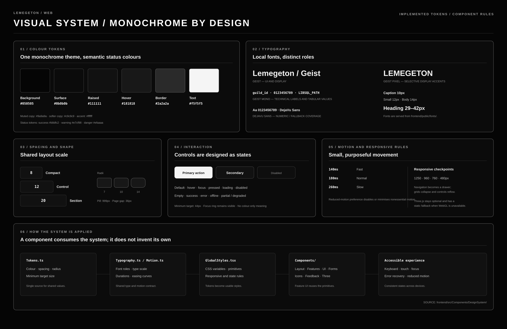
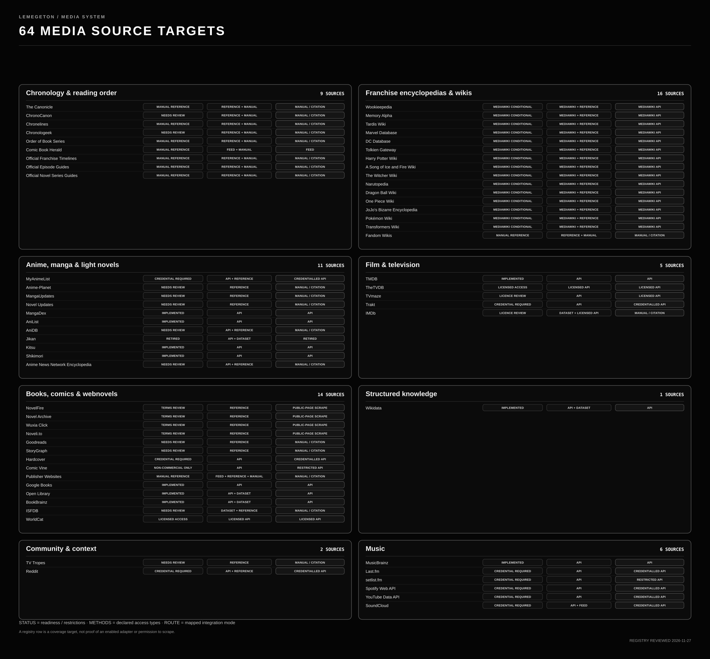
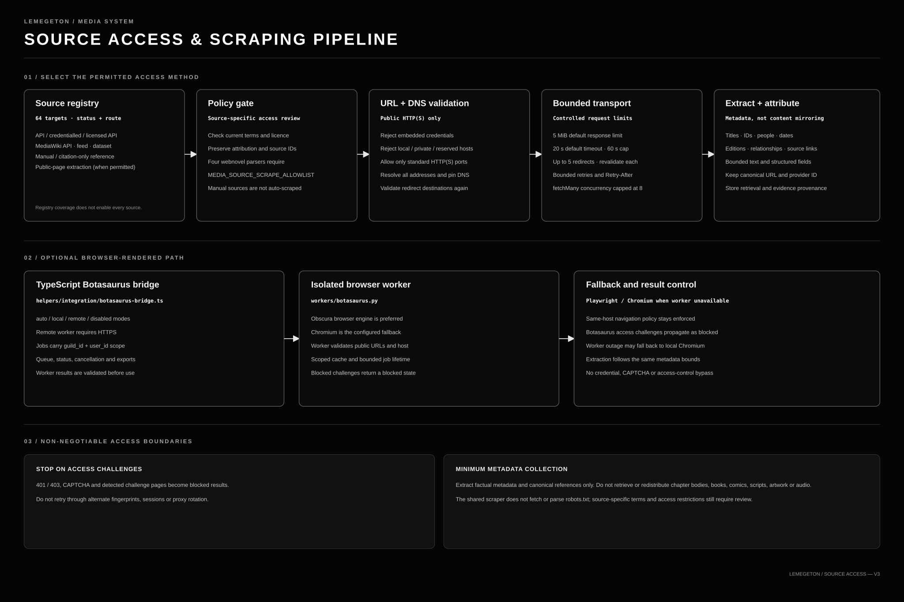
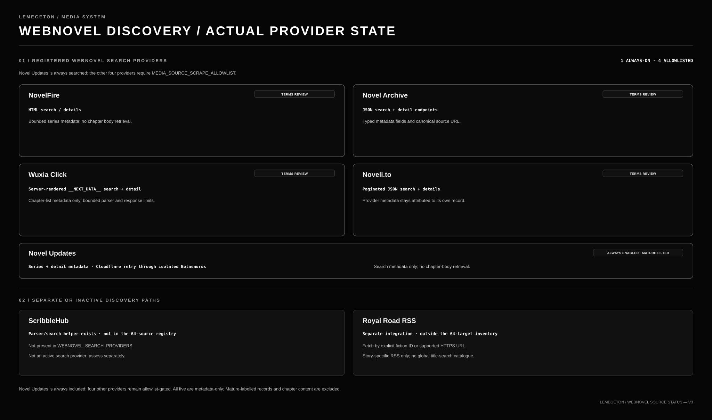
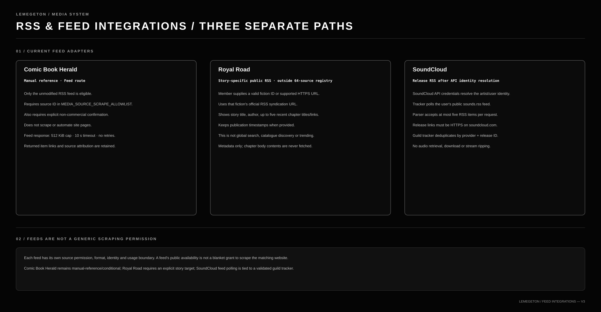
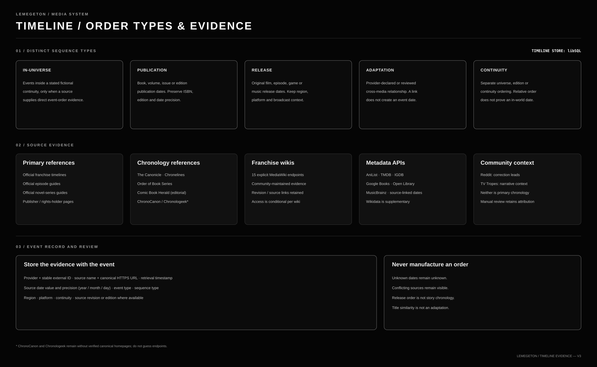
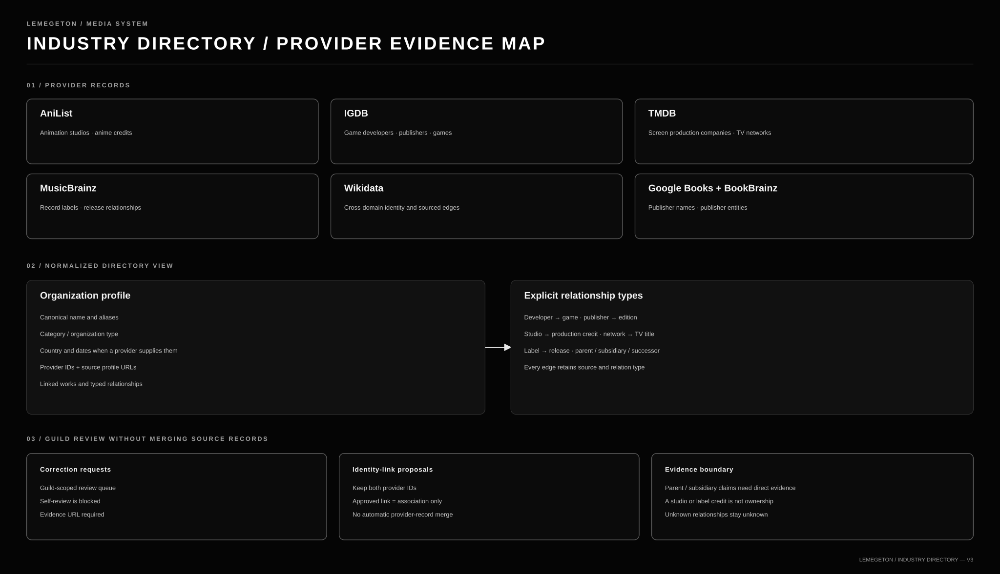

  &nbsp;&nbsp;
  

<strong>DISCOVER · CONNECT · CREATE</strong>

Lemegeton is a multi-guild Discord bot for discovering anime, manga, books, webnovels, films, television, games and music. It brings media search, recommendations, shared archives and community activities into Discord, with an optional web dashboard.

  <a href="docs/README.md">DOCUMENTATION</a> ·
  <a href="docs/ARCHITECTURE.md">ARCHITECTURE</a> ·
  <a href="web/README.md">DASHBOARD</a> ·
  <a href="docs/legal/PRIVACY_POLICY.md">PRIVACY</a> ·
  <a href="docs/legal/TERMS_OF_SERVICE.md">TERMS</a> ·
  <a href="docs/legal/README.md">POLICY CENTRE</a> ·
  <a href="CONTRIBUTING.md">CONTRIBUTE</a>

  

    
    
    
  

  

    
    
    
    
    
    
    
    
    
  

  

    
    
    
    
    
  

  

    
    
    
  

---

## WHAT IS LEMEGETON?

Lemegeton is a community-focused Discord bot built around media discovery and shared participation. Members can look up works across supported providers, explore related titles, compare metadata, contribute to community archives, take part in recurring activities and play media-themed games — without leaving their server.

It supports multiple Discord guilds in one runtime. Each server keeps its own configuration and community data, while shared provider metadata can support discovery across categories. The optional dashboard gives authorised server managers a browser-based control plane; the Discord bot remains the primary member interface and the authority for command execution.

The project is organised around three connected activities:

| Discover | Share | Participate |
|:--|:--|:--|
| Search media across supported providers, compare records and explore source-backed relationships. | Build community archives, submit and curate entries, and contribute links or media with clear provenance. | Join daily activities, rankings, sessions, tournaments and group games. |

## COMMANDS

Lemegeton's feature commands are grouped by purpose rather than exposing every operation as a separate top-level command.

| Command | What it covers |
|:--|:--|
| **/discover** | Search and browse supported media; compare records, find similar works, inspect franchises and explore the Knowledge Atlas. |
| **/archive** | Access community archives, submit and organise entries, manage collections and support server curation. |
| **/community** | Daily activities, rankings, sessions, reading/community events, tournaments and community delivery. |
| **/play** | Start and take part in group quizzes and media games. |
| **/profile** | View profile information, manage supported provider links and access profile-related privacy controls. |
| **/custom-role** | Create, customise and manage eligible member roles through the bot's role tools and picker. |
| **/music** | Discover artists, discographies, releases, charts and setlists; supported deployments can configure music notifications. |
| **/settings** | Configure server-level options and protected setup choices. |

A few commands deliberately remain separate:

- **/help** explains the bot and its command groups.
- **/privacy** provides the privacy and data-control entry point.
- **/feedback** sends feedback through the diagnostic and feedback workflow.
- **/language** completes the server's language setup. The server must also make its required data-retention choice before normal guild features unlock.
- Restricted operator commands remain separate from the member-facing feature groups.

Command availability is enforced by the bot for the current guild. Hiding a command or control in the dashboard is not treated as an authorization check.

## HOW THE SYSTEM FITS TOGETHER

  

A Discord interaction enters the single **discord.js** client in **bot.ts**. The command registry in **src/registry.ts** dispatches it to a command module in **src/commands/** or **src/standalone/**. Command modules keep Discord-specific interaction handling close to the platform; reusable domain operations live in **helpers/**.

The helpers layer connects discovery, archives, community systems, Custom Roles, provider adapters, runtime operations and security controls. Provider-specific request and response logic stays in **helpers/integration/**, while shared media operations and provenance handling stay in **helpers/media/**. Scheduled work is started and stopped with the bot runtime.

The web dashboard is a separate control plane, not a second bot. Its Next.js frontend is statically exported, and the Rust/Axum service handles OAuth, sessions, CSRF checks, guild authorization and approved API requests. Where a dashboard action needs the bot, Rust uses the bot's private bridge. Both processes use the same authoritative libSQL store.

## REPOSITORY STRUCTURE

The map below is a responsibility guide to the current v3 tree. It shows the important entry points and the boundaries between Discord runtime code, domain services, storage, the optional dashboard, and project operations. It is not intended to list every source file.

  

| Location | Responsibility |
|:--|:--|
| **`bot.ts`** | Single Discord client, gateway lifecycle, scheduled workers and private dashboard bridge startup. |
| **`src/commands/`** | Consolidated feature commands and protected server setup. |
| **`src/standalone/`** | Help, privacy, feedback, logging and restricted operator commands. |
| **`src/utility/`** | Utility commands and database-specific native storage packages. |
| **`src/integrations/`** | Message-driven integrations that are not slash-command modules. |
| **`helpers/`** | Shared media, archive, community, Custom Roles, provider, runtime, dashboard and security services. |
| **`workers/`** | Optional isolated Botasaurus browser worker; not a second bot runtime. |
| **`web/frontend/`** | Next.js App Router, React interface, local assets, design system and browser tests. |
| **`web/backend/`** | Rust/Axum dashboard service, sessions, API and authorization boundary. |
| **`tests/`** · **`web/frontend/tests/`** | Bot, provider, storage, UI, component and browser-level test suites. |
| **`docs/`** · **`assets/`** | Architecture, feature and policy documentation; diagrams and brand artwork. |
| **`.github/`**, **`deploy/`**, **`scripts/`** | CI/security automation, deployment definitions and build/acceptance tooling. |

For runtime flow, guild boundaries and storage ownership, see [Architecture](docs/ARCHITECTURE.md). For the web code map and interface design, see the [Web README](web/README.md).

## WEB EXPERIENCE AND VISUAL SYSTEM

The dashboard uses a single monochrome theme, local typography, a first-party SVG icon registry and a token-based layout system. The diagram shows the implemented design language—not a proposed theme or component library.

  

The frontend is organised around the App Router, a dashboard shell and feature-owned screens. Its component map separates layout, design tokens, forms, iconography, reusable UI, feedback states and optional WebGL visuals.

  

See [web/README.md](web/README.md) for the visual-system rules, source map, public routes, security boundary and local verification commands.

## DATA AND MULTI-GUILD DESIGN

Lemegeton separates application records from private binary objects:

- **Shared libSQL database:** guild configuration, command settings, profiles, archive and community records, consent, dashboard sessions, OAuth state, rate limits and related metadata.
- **Private RocksDB object store:** media objects and Custom Role image bytes. Object metadata, guild ownership and authorization remain in libSQL.
- **Provider services:** supply their own media metadata. A provider response is not silently converted into a confirmed relationship or a community-approved fact.

Guild-owned data is scoped through the invoking **guild_id** across command, helper, database, cache, dashboard and scheduled-worker paths. Shared catalogue information is distinct from private guild settings and submissions. Permission checks are repeated at the point of a protected action; a client-supplied guild ID alone is never authority.

During first-time server setup, an authorised inviter or a member with Manage Server chooses the guild's retention policy and completes the language setup. Normal guild functionality remains gated until the required retention choice is recorded. If the bot later leaves a server, the selected retention policy determines whether guild data is deleted or retained.

The dashboard and bot do not create separate active databases. The Rust dashboard uses the same shared Rust storage crate and **LIBSQL_PATH** as the bot. RocksDB remains the private object store. PostgreSQL and S3 are not part of the current v3 storage architecture.

## MEDIA AND SERVICE INTEGRATIONS

Lemegeton keeps source identity, access method, readiness and provenance separate. Its Timeline and Industry research inventory contains **64 unique source targets across eight categories**; those entries are not a claim that every source is currently enabled or automatically scraped.

  

| Area | Current v3 integrations |
|:--|:--|
| Anime and manga | AniList, Kitsu, MangaDex and Shikimori; other catalogue targets have separate credential or review requirements. |
| Books and novels | Google Books, Open Library, BookBrainz and Crossref ISBN matching. |
| Webnovels | Novel Updates metadata search is always included, with a targeted Botasaurus Cloudflare-challenge retry; four additional parsers remain `MEDIA_SOURCE_SCRAPE_ALLOWLIST`-gated. Mature-labelled entries are filtered. Royal Road provides story-specific RSS metadata; ScribbleHub remains inactive. |
| Film and television | TMDB, with additional TV/database sources explicitly marked as credential, licence or review dependent. |
| Video games | IGDB and Steam. |
| Music | MusicBrainz, plus credentialed Last.fm, setlist.fm, Spotify, YouTube Data API and SoundCloud integrations. |
| Chronology and industry | 64-source inventory, 15 conditional MediaWiki endpoints, source-backed Timeline events and typed Industry records. |

The registry and integration-mode map identify whether a source is API-backed, credentialed, licensed, MediaWiki, feed, manual or scraping-based, and whether it is implemented, gated, under review, restricted or retired.

**The scraper is not a universal “fetch any URL” layer.** It validates public destinations, pins DNS, revalidates redirects, and bounds response size/time/concurrency. Cloudflare challenge handling is enabled by default for Botasaurus requests and can be disabled per request; optional Turnstile solving stays disabled until an operator configures a supported provider and API key. Generic access denials, login/paywall gates, IP blocks, and rate limits remain blocked. Source-specific access permissions and reuse terms still govern each source.

See the [Media Sources & Scraping guide](docs/MEDIA_SOURCES.md) for all 64 targets, the scraping pipeline, webnovel provider states, Timeline order types and Industry provider map. Original source intentions remain in [Command Expansions](Command%20Expansions.md#source-inventory-and-integration-strategy).

## SOURCE ACCESS AND SCRAPING

  

  

  

## TIMELINE, INDUSTRY AND MUSIC PROVIDERS

  

  

  

See [Media Sources & Scraping](docs/MEDIA_SOURCES.md) for detailed provider states, boundaries and implementation references.

Lemegeton distinguishes provider-generated recommendations, source-declared relationships, local metadata-overlap matches, exact-title matches and community-reviewed links. Similar titles are not automatically treated as adaptations, sequels or part of the same franchise. Missing provider fields remain missing rather than being guessed.

See [Media Discovery](docs/MEDIA_DISCOVERY.md) and the [Third-Party Services Disclosure](docs/legal/THIRD_PARTY_DISCLOSURE.md) for current provider details and request boundaries.

## OPTIONAL WEB DASHBOARD

The dashboard is intended for authorised server managers and operators. It provides browser-based access to supported guild configuration, command/access settings, activity and audit views, integrations, diagnostics, status and the Knowledge Atlas.

It uses:

- **Next.js and React** for the static-export frontend and interactive screens.
- **Rust and Axum** for Discord OAuth, sessions, API requests, CSRF/origin validation and authorization.
- **The private TypeScript bot bridge** for approved operations that must be applied by the running bot.
- **The same libSQL database** used by the bot for configuration, sessions and related state.

The public status page exposes a limited health summary; it does not expose private sessions, guild configuration, raw logs or bridge credentials. The dashboard is optional and does not replace Discord-side permissions or the bot's own authorization checks.

See the [Web README](web/README.md) and [Dashboard & Deployment Guide](docs/DASHBOARD.md).

## QUICK START

### Requirements

- Node.js 22.9 or later and npm.
- Rust stable and Cargo.
- A C/C++ build toolchain and RocksDB development headers for the native storage addon.
- A Discord application with a bot token and the required application settings.
- Provider credentials only for integrations that require them.
- Dashboard OAuth configuration only when deploying the optional dashboard.

### Install

~~~bash
git clone https://github.com/Kyerstorm/Lemegeton.git
cd Lemegeton
npm install --no-audit --no-fund
cp .env.example .env
~~~

Configure the environment in **.env**. At minimum, provide the Discord bot credentials and persistent paths for **LIBSQL_PATH** and **ROCKSDB_PATH**. Configure OAuth values and provider credentials only for the features you intend to enable. Never commit **.env** or production secrets.

### Build and run

~~~bash
npm run typecheck
npm test
npm run build
npm start
~~~

Register the slash-command inventory with:

~~~bash
npm run deploy:commands
~~~

For the combined bot/dashboard deployment, Docker, Railway and VPS options, see [deployment documentation](docs/DASHBOARD.md) and [VPS setup](deploy/vps/README.md). The supported combined runtime entry point is **scripts/start.sh**.

## DEVELOPMENT AND VERIFICATION

Use the checks relevant to the part of the system being changed.

| Area | Checks |
|:--|:--|
| Bot | **npm run typecheck**, **npm test**, **npm run build** |
| Dashboard frontend | **npm run typecheck --prefix web/frontend**, **npm run build --prefix web/frontend** |
| Dashboard backend | **cargo fmt --manifest-path web/backend/Cargo.toml -- --check**, **cargo test --manifest-path web/backend/Cargo.toml** |
| Startup and deployment | **bash -n scripts/start.sh**, **docker compose config --quiet**, **docker build --tag lemegeton:local .** |

Tests use isolated local storage where appropriate. CI does not replace live acceptance of Discord permissions, OAuth application settings, provider credentials, production storage and backup/restore behavior.

Contributors should read [AGENTS.md](AGENTS.md), [Contributing](CONTRIBUTING.md) and the [CI guide](docs/CI.md) before making changes.

## PRIVACY, TERMS AND POLICIES

These documents describe the project's current policy set. Hosted operators must still provide deployment-specific contact details, configure their providers and retention practices, and verify their own legal and operational responsibilities.

| Document | Purpose |
|:--|:--|
| [Privacy Policy](docs/legal/PRIVACY_POLICY.md) | Information processed, purposes, storage, retention and privacy requests. |
| [Terms of Service](docs/legal/TERMS_OF_SERVICE.md) | Conditions for using the bot and optional dashboard. |
| [Community Guidelines](docs/legal/COMMUNITY_GUIDELINES.md) | Member conduct, submissions, moderation and spoilers. |
| [Third-Party Disclosure](docs/legal/THIRD_PARTY_DISCLOSURE.md) | External providers and data sent for selected features. |
| [Data deletion and privacy requests](docs/legal/DATA_DELETION_AND_PRIVACY_REQUESTS.md) | Internal procedure for handling privacy requests. |
| [DMCA & Copyright Policy](docs/legal/DMCA.md) | Copyright notices and removal procedure. |
| [Copyright & Content Complaints](docs/legal/COPYRIGHT_AND_CONTENT_COMPLAINTS.md) | Rights-holder reporting route. |
| [Intellectual Property Notice](docs/legal/INTELLECTUAL_PROPERTY.md) | Software, user submissions and third-party rights. |
| [Open-Source & Third-Party Licences](docs/legal/OPEN_SOURCE_LICENSES.md) | Project and dependency licence information. |
| [Security Policy](docs/legal/SECURITY.md) | Private vulnerability reporting. |
| [Legal & Privacy Index](docs/legal/README.md) | Public policies and internal operational procedures. |

Lemegeton does not sell personal data. The privacy notice explains that information and retention practices depend on enabled features and the specific deployment. The legal index also distinguishes public-facing policies from internal readiness and response documents.

## DOCUMENTATION

| Guide | What it covers |
|:--|:--|
| [Documentation index](docs/README.md) | Current project guides and specifications. |
| [Architecture](docs/ARCHITECTURE.md) | Execution flow, module responsibilities and guild boundaries. |
| [Media Discovery](docs/MEDIA_DISCOVERY.md) | Providers, browsing, recommendations and relationship provenance. |
| [Dashboard](docs/DASHBOARD.md) | Frontend, Rust API, OAuth, private bridge and deployment. |
| [Data Backups](docs/DATA_BACKUPS.md) | Backup creation, verification and recovery boundaries. |
| [Command Expansions](Command%20Expansions.md) | Consolidated command systems and expansion notes. |
| [Custom Roles Specification](docs/CUSTOM_ROLES_SPEC.md) | Role lifecycle and configuration requirements. |
| [CI and Verification](docs/CI.md) | Automated checks and live acceptance. |
| [Issue Reference Format](docs/ISSUE_REFERENCE_FORMAT.md) | Diagnostic issue-reference contract. |
| [Contributing](CONTRIBUTING.md) | Development setup and change expectations. |
| [MIT Licence](docs/LICENSE) | Project source-code licence. |

  
  
  
  
  LEMEGETON / V3

