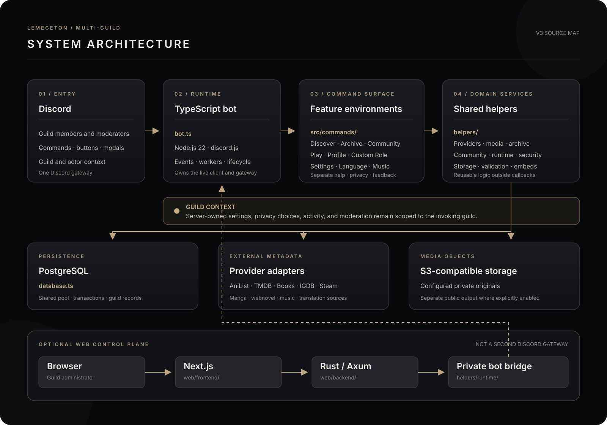

<div align="center">


<h1>LEME<br />GETON</h1>

<p><strong>MEDIA INTELLIGENCE · COMMUNITY · CONNECTION</strong></p>
<p>A Discord-native home for discovering media, connecting knowledge, and building communities.</p>

<p>
  <a href="docs/README.md">DOCUMENTATION</a>
  &nbsp;·&nbsp;
  <a href="docs/ARCHITECTURE.md">ARCHITECTURE</a>
  &nbsp;·&nbsp;
  <a href="CONTRIBUTING.md">CONTRIBUTE</a>
  &nbsp;·&nbsp;
  <a href="SECURITY.md">SECURITY</a>
</p>

[](https://github.com/Kyerstorm/Lemegeton/actions/workflows/ci-bot.yml)
[](https://nodejs.org/)
[](https://discord.js.org/)
[](https://www.postgresql.org/)
[](docs/DASHBOARD.md)
[](docs/LICENSE)

</div>

---

## The project

Lemegeton is a multi-guild Discord bot for media discovery and community participation. It brings related media, shared resources, community activities, and server configuration into one connected experience.

| Discover | Contribute | Participate | Shape your server |
|:--|:--|:--|:--|
| Anime, manga, books, novels, webnovels, film, television, and games | Curated archives, knowledge links, and shared collections | Daily Drops, rankings, sessions, discussions, and media games | Guild settings, language, retention, themes, and Custom Roles |

Recommendations, provider-declared relationships, local matches, and community-reviewed links remain distinct. A suggestion is never presented as proof of an adaptation or shared continuity.

## Command environments

| Command | What it opens |
|:--|:--|
| `/discover` | Search, browse, compare, and explore supported media |
| `/archive` | Submit, curate, organise, and discover community resources |
| `/community` | Daily activities, rankings, sessions, discussions, and events |
| `/play` | Interactive media quizzes and group games |
| `/profile` | Provider connections, profiles, privacy, and community comparisons |
| `/custom-role` | Member Custom Roles and server-side management |
| `/settings` | Guild configuration and protected server controls |
| `/music` | Guild-scoped artist releases and notification controls |

`/language` is part of required server setup. A guild must configure both its language and data-retention choice before normal feature commands and dashboard guild routes become available.

`/help`, `/privacy`, and `/feedback` remain standalone commands. Restricted operator commands and utilities are documented in the command registry and help interface.

## Architecture

<p align="center">
  
</p>

The diagram is a static, versioned SVG built from the current source layout. It does not depend on a Mermaid renderer. See the [architecture guide](docs/ARCHITECTURE.md) for execution flow, service boundaries, and the source map.

## Integrations

Provider-specific adapters keep metadata and source coverage explicit. The current integration layer includes AniList, Kitsu, MangaDex, Open Library, Google Books, Crossref, Royal Road, TMDB, IGDB, Steam, translation providers, and public webnovel discovery.

The optional music-release environment uses Spotify, YouTube Data API, and SoundCloud where the corresponding credentials and public endpoints are available. Optional S3-compatible storage handles configured media assets.

Provider availability and fields differ. Missing metadata, unavailable credentials, or blocked public pages are reported as unavailable rather than filled with invented information.

## Get started

**Requirements:** Node.js 22.9+, npm, PostgreSQL, and a Discord application. Rust/Cargo and dashboard dependencies are required only when building the web dashboard.

```bash
git clone https://github.com/Kyerstorm/Lemegeton.git
cd Lemegeton
npm install --no-audit --no-fund
cp .env.example .env
```

Configure the Discord application credentials and PostgreSQL connection in `.env`. Add provider, S3, and dashboard credentials only for the features you intend to run. Never commit a populated environment file.

```bash
npm run typecheck
npm test
npm start
```

Register slash commands with:

```bash
npm run deploy:commands
```

For the combined bot and dashboard deployment, follow the [dashboard guide](docs/DASHBOARD.md) and [VPS deployment guide](deploy/vps/README.md). The combined startup script expects the built Next.js export and Rust dashboard binary; `npm start` runs the bot independently.

## Configuration

The complete variable list, defaults, and comments live in [`.env.example`](.env.example). The main groups are:

| Group | Purpose |
|:--|:--|
| Discord | Bot token, application ID, moderator server, and feedback routing |
| PostgreSQL | Connection URL or host settings, TLS, and pool size |
| Metadata providers | AniList, TMDB, IGDB, Steam, books, and webnovel sources |
| Music | Optional Spotify, YouTube Data API, and SoundCloud credentials |
| Storage | S3 endpoint, bucket, credentials, and signed URL lifetime |
| Dashboard | OAuth, public origin, sessions, and private bot bridge |
| Guild features | Language, retention, archive, notifications, and Custom Roles |

## Documentation

| Guide | Coverage |
|:--|:--|
| [Documentation index](docs/README.md) | All current project guides |
| [Architecture](docs/ARCHITECTURE.md) | Runtime diagram, module map, data flow, and guild boundaries |
| [Dashboard](docs/DASHBOARD.md) | Next.js, Rust/Axum, OAuth, bridge, and deployment |
| [Media discovery](docs/MEDIA_DISCOVERY.md) | Providers, search, relationships, and attribution |
| [Security policy](SECURITY.md) | Private vulnerability reporting |
| [Security review](docs/SECURITY_AUDIT.md) | Source-level findings, controls, and residual risks |
| [CI and verification](docs/CI.md) | Automated checks and manual live acceptance |
| [Data backups](docs/DATA_BACKUPS.md) | Backup verification and recovery boundaries |
| [Privacy policy](docs/PRIVACY_POLICY.md) | Data processing, storage, and retention |
| [Community guidelines](docs/COMMUNITY_GUIDELINES.md) | Archive submissions and moderation |
| [Contributing](CONTRIBUTING.md) | Development and review expectations |
| [Terms of service](docs/TERMS_OF_SERVICE.md) | Service conditions |
| [License](docs/LICENSE) | MIT |

## Development

The Discord gateway is owned by `bot.ts`. Command environments are registered in `src/registry.ts`; reusable provider, domain, storage, and security logic belongs in `helpers/`. Preserve guild scope on server-owned state and verify permissions again for component interactions.

Run the checks relevant to your changes:

```bash
npm run typecheck
npm test
npm run typecheck --prefix web/frontend
npm run build --prefix web/frontend
cargo fmt --manifest-path web/backend/Cargo.toml -- --check
cargo test --manifest-path web/backend/Cargo.toml
```

See [CONTRIBUTING.md](CONTRIBUTING.md) and [CI.md](docs/CI.md). A listed command is not evidence that a check passed; use the result from the exact commit being reviewed.

## Security

Keep Discord, database, provider, S3, OAuth, and bridge credentials out of Git and logs. Use least-privilege Discord permissions, keep private media objects private, and preserve current guild authorization checks.

Report security vulnerabilities through the process in [SECURITY.md](SECURITY.md). For ordinary defects or feature requests, use [GitHub Issues](https://github.com/Kyerstorm/Lemegeton/issues) or `/feedback`.

<details>
<summary>Repository statistics</summary>

<!-- REPO-STATS:START -->
Statistics are generated from tracked text and source files after changes are integrated.
<!-- REPO-STATS:END -->

</details>

---

<div align="center">
  <strong>Discover more. Connect the dots. Build together.</strong>
</div>
