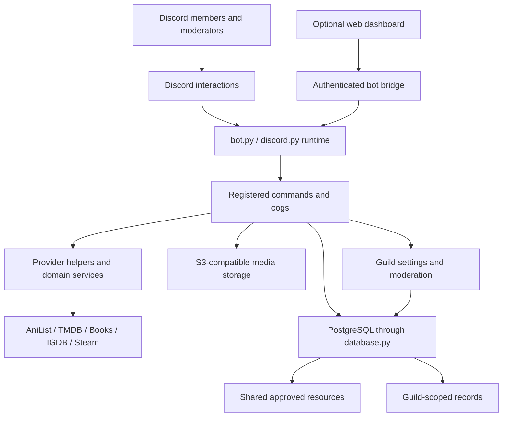
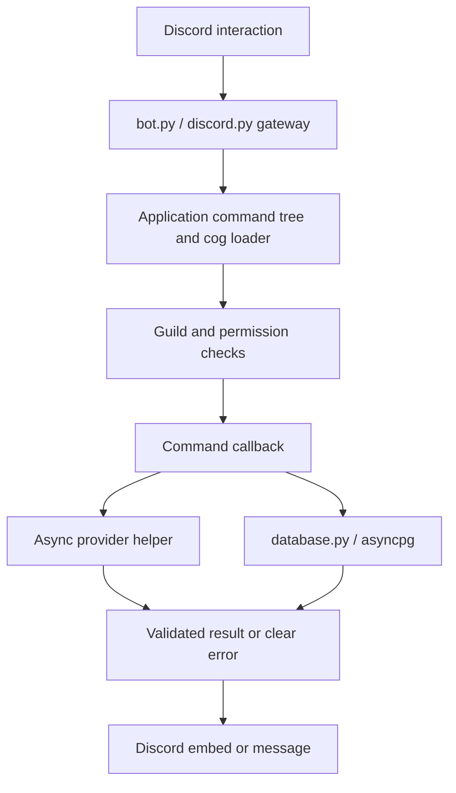
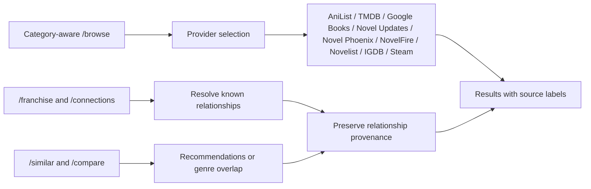
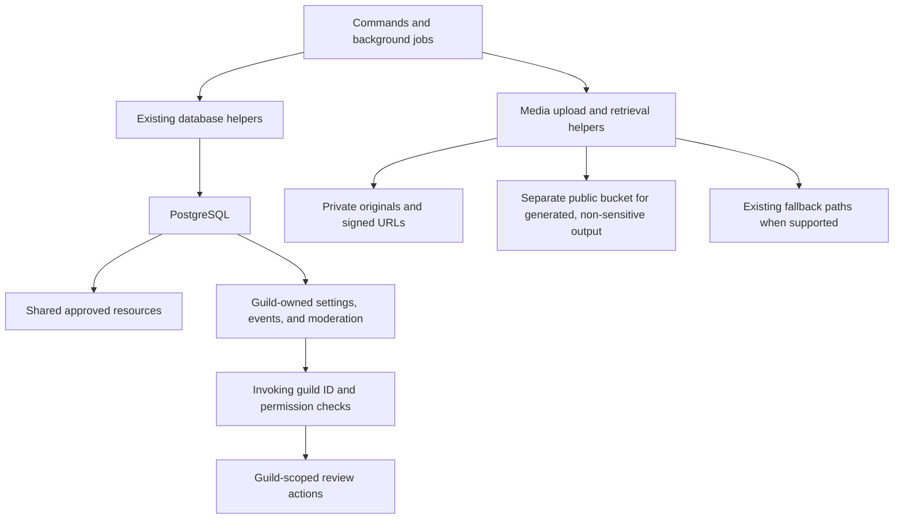
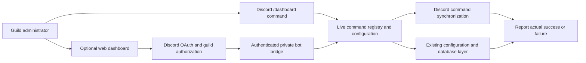
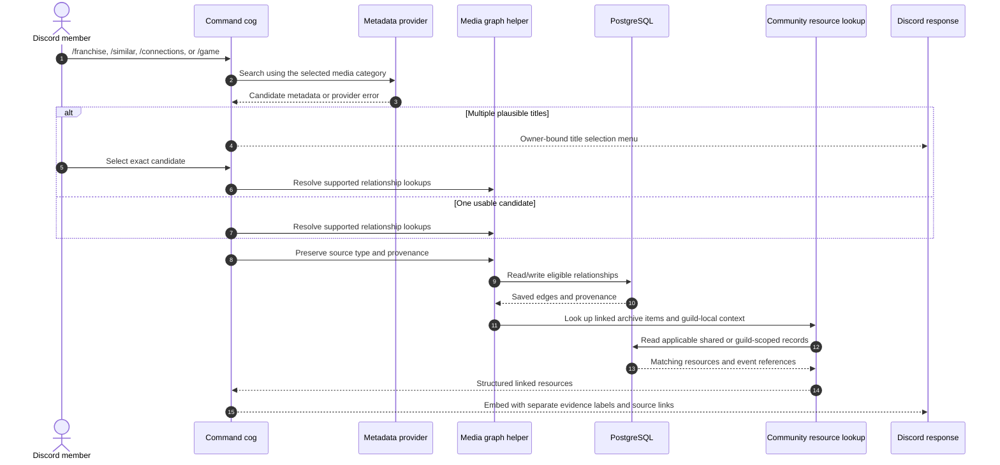
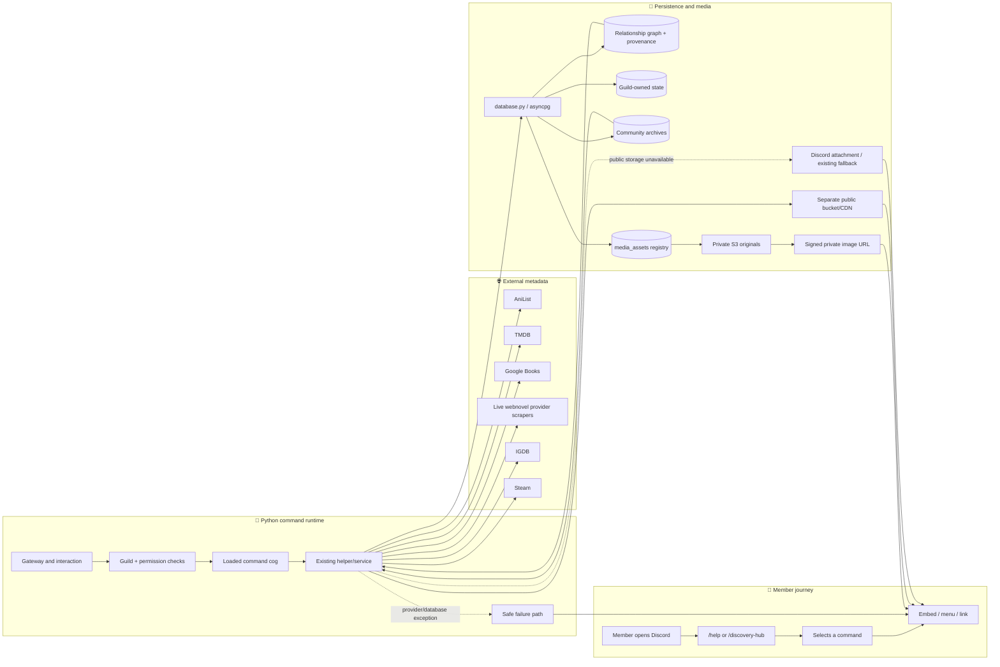
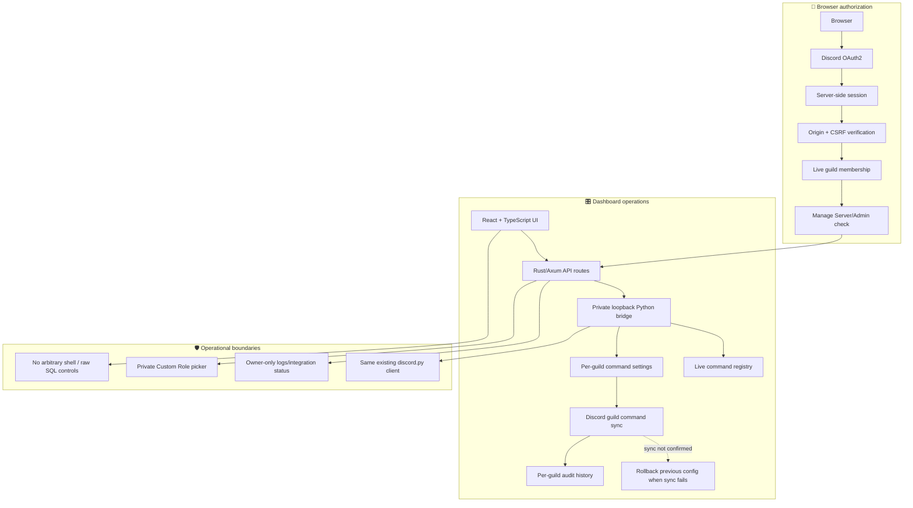
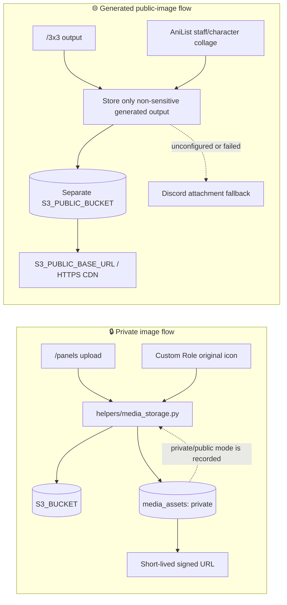

# L E M E G E T O N

### One Discord bot. Many media worlds. One connected community layer.

Discover anime, manga, novels, webnovels, films, television, and video games — then connect what belongs together without mistaking a recommendation for a confirmed adaptation.

**Lemegeton is a multi-guild Discord bot built around media discovery, cross-provider relationships, community features, and per-server control.**

[Features](#-what-lemegeton-does) · [Statistics](#-repository-statistics) · [Architecture](#-system-architecture) · [Commands](#-command-map) · [Getting started](#-getting-started) · [Configuration](#-configuration) · [Dashboard](#-web-dashboard) · [Development](#-development--verification)

---

## 🧾 Contents

- [What Lemegeton does](#-what-lemegeton-does)
- [Repository statistics](#-repository-statistics)
- [System architecture](#-system-architecture)
- [How media becomes connected](#-how-media-becomes-connected)
- [Command map](#-command-map)
- [Shared data and multi-guild boundaries](#-shared-data-and-multi-guild-boundaries)
- [Media storage and privacy](#-media-storage-and-privacy)
- [Web dashboard](#-web-dashboard)
- [Getting started](#-getting-started)
- [Configuration](#-configuration)
- [Development and verification](#-development--verification)
- [Repository map](#-repository-map)
- [Operational boundaries](#-operational-boundaries)
- [Documentation](#-documentation)
- [Contributing](#-contributing)
- [License and support](#-license-and-support)

## 📊 Repository statistics

The figures below are generated from repository files and are refreshed automatically by GitHub Actions after pushes to `multi_guild` and on a weekly schedule. Source lines are counted separately from documentation/configuration text; character counts exclude line breaks.

<!-- REPO-STATS:START -->
| Metric | Current total |
|:--|--:|
| Tracked files | 232 |
| Text files scanned | 228 |
| Source code files | 194 |
| Source lines (including blank lines) | 94,985 |
| Non-blank source lines | 82,730 |
| Text lines (code, docs, and configuration) | 98,830 |
| Characters (excluding line breaks) | 4,418,676 |
| Text file size | 4.3 MB |
| Source line breakdown | Python: 88,486 lines; JavaScript / TypeScript: 3,996 lines; Rust: 938 lines; Shell: 749 lines; CSS / Sass: 564 lines; HTML / SVG: 252 lines |
| Last refreshed (UTC) | 2026-10-29 08:18 UTC |
<!-- REPO-STATS:END -->

## ✦ What Lemegeton does

Lemegeton brings media search and community interaction into the same Discord experience. It uses established metadata sources, records the origin of relationships, and keeps guild-specific workflows separate.

### 🗃️ Discover across categories

| Domain | What it covers | Primary data sources |
|---|---|---|
| Anime and manga | Search, browse filters, airing/publication metadata, tags, themes, and supported relationships | AniList |
| Light novels, books, and general novels | Title and author search, available edition information, and supported metadata links | AniList where applicable; Google Books |
| Webnovels | Live public metadata from four independent webnovel providers | Novel Updates, Novel Phoenix, NovelFire, and Novelist |
| Movies and television | Search, genre filters, series/season/episode data, credits, videos, collections, and listed watch providers | TMDB |
| Video games | Game metadata with optional store enrichment | IGDB; Steam |
| Community-created resources | Attributed quotes, fanworks, moodboards, soundtrack links, scenes, theories, and member-written recommendations | Lemegeton's database-backed archive |

Provider availability and metadata coverage differ. Lemegeton does not invent dates, ratings, episode mappings, or adaptation relationships when a provider does not supply them.

### 🧬 Connect related works without collapsing the evidence

The discovery layer brings together multiple kinds of evidence:

- **Provider-declared relationships** — a relationship explicitly described by a metadata provider.
- **Provider recommendations** — suggestions returned by a provider, labelled as recommendations.
- **Local genre overlap** — a transparent match based on shared, normalized genre labels.
- **Community-verified links** — member suggestions reviewed by a moderator in the relevant guild.

Those categories remain distinct. Similar titles, shared genres, and recommendations are **not** treated as proof that two works share a continuity or adaptation relationship.

### 👥 Make discovery social

- Server-local Reading Club nominations, votes, and scheduled discussions.
- Media Night and community polls, brackets, adaptation voting, and source-linked trivia.
- Spoiler-aware chapter and episode discussion threads.
- Shared media archives with attribution, review queues, and report flows.
- AniList profile displays, affinity comparisons, leaderboards, and other existing community commands.

### 🏠 Give each guild its own controls

Lemegeton can operate in multiple Discord servers. Server configuration, command overrides, streaming-region defaults, release calendars, discussions, votes, and moderator review actions use guild context where a feature is server-specific. Shared public resources, such as approved archive entries and safe manga panels, can be discovered from more than one server, while moderation controls remain scoped to the relevant server.

### 🎛️ Keep administration connected to the running bot

The Discord **/dashboard** command and optional web dashboard operate on the live command registry and existing configuration layer. The web service does not create a second Discord gateway or simulate successful command changes when the bot bridge or Discord synchronization fails.

---

## 🧭 System architecture

This architecture map connects command entry points, provider integrations, relationship evidence, PostgreSQL, image storage, and the optional web control plane.

### Runtime and command execution

### Media discovery and evidence

### Database, media storage, and multi-guild boundaries

### Dashboard and control plane

### 🧠 Read the architecture from the outside in

1. **Discord is the entry point.** The Python process owns the live gateway, slash-command tree, cog loading, interactions, and command errors.
2. **Commands reuse providers.** Search and selection code reuse the AniList, TMDB, Google Books, Novel Updates, Novel Phoenix, NovelFire, Novelist, IGDB, and Steam integrations instead of inventing a universal metadata source.
3. **The graph records evidence, not certainty.** Relationship edges, provider recommendations, local genre overlap, and reviewed community submissions keep separate provenance.
4. **PostgreSQL stores structured data; S3 stores selected image files.** The media-assets registry connects records to object keys and privacy mode, while private and public objects follow separate access rules.
5. **The web dashboard is a control plane, not a second bot.** Rust handles the public browser-facing service and authorization; private loopback services connect authenticated operations to the existing Python bot.
6. **Runtime state wins over README assumptions.** /help and the Discovery Hub aim to list commands that are actually registered, while credentials, guild settings, and Discord permissions can still limit an individual operation.

---

## 🔗 How media becomes connected

A typical cross-media lookup follows this path:

### 🔎 Evidence types

| Evidence type | What it means | What it does **not** mean |
|---|---|---|
| Provider-declared relation | The source provider explicitly describes a relationship | The provider's metadata is complete or infallible |
| Provider recommendation | The source provider recommends a title | A sequel, shared universe, adaptation, or chronology is confirmed |
| Local genre overlap | Titles share genre labels after conservative normalization | A model generated the ranking or predicted story similarity |
| Community-verified link | A guild moderator reviewed a member proposal | The provider independently confirmed the relationship |
| Exact-title match on another provider | The title appears on a second metadata source | Name similarity by itself proves an adaptation |

See [Media Discovery documentation](docs/MEDIA_DISCOVERY.md) for browse filters, franchise exploration, TV guides, the release calendar, Reading Club, Media Night, and comparisons.

---

## 🗺️ Command map

Type / in Discord or use **/help** to see commands registered in the running bot. The table below describes the principal command families; exact visibility depends on loaded cogs, provider configuration, and server permissions.

### 🧬 Media search and cross-media discovery

| Command | Purpose |
|---|---|
| **/browse** | Search supported media types with category-specific filters. |
| **/franchise** | Explore provider-declared relationships, collections, and clearly labelled cross-provider matches. |
| **/connections** | Resolve a selected title and navigate supported relationships. |
| **/similar** | Combine provider suggestions, shared-genre matches, saved links, and eligible community recommendations. |
| **/compare** | Compare two to four media entries, including supported mixed-category comparisons. |
| **/discovery-hub** | Open a dropdown guide to media discovery and community features. |
| **/link-suggest** | Open a guided relationship selector and evidence modal for moderator review. |
| **/link-review** | List, inspect, approve, or reject relationship suggestions in the current server. |

### 🎬 Movies and television

| Command | Purpose |
|---|---|
| **/where-to-watch** | Display TMDB-listed streaming, rental, and purchase availability by region when supplied. |
| **/person-credits** | Explore a TMDB person's combined film and television credits. |
| **/trailers** | Browse TMDB-listed videos, trailers, and teasers. |
| **/collection-guide** | Browse a movie's listed TMDB collection and films. |
| **/tv-guide** | Show supported TV series, season, and episode details. |
| **/release-calendar** | Preview releases or configure/disable this server's digest through one interactive menu. |
| **/media-region** | Set the guild's default country code for streaming availability. |
| **/discussion** | Create a spoiler-aware chapter, volume, episode, season, or general media thread. |

TMDB-powered features require TMDB_BEARER_TOKEN. Availability data changes, and a missing provider record is not proof that a title is unavailable.

### 📚 Books, novels, and webnovels

| Command | Purpose |
|---|---|
| **/author-works** | Search Google Books for titles attributed to an author. |
| **/webnovel-updates** | Search live Novel Updates, Novel Phoenix, NovelFire, and Novelist pages for current public webnovel metadata. |
| **/reading** | Open the unified Reading Hub for nominations, votes, selection, scheduled discussions, and reading order. |

Live webnovel search combines public metadata from Novel Updates, Novel Phoenix, NovelFire, and Novelist. Each provider is parsed independently, so a failure at one source does not discard the others. Results depend on the sites’ current page structures and availability; an empty response is not necessarily proof that a title does not exist. Novelist’s central public catalogue currently says stories are coming soon; its adapter checks public discovery routes and uses a normal browser-rendered fallback when available, but it cannot return catalog results until Novelist opens public discovery.

Results explicitly marked adult-rated or sexually explicit are excluded.

### 🎮 Games and generated images

| Command | Purpose |
|---|---|
| **/game** | Search IGDB game records and add Steam store details when a suitable exact match is found. |
| **/steam-game** | Search Steam's store listing and display supported game information. |
| **/steam-profile** | Display supported Steam profile and library information. |
| **/steam-recommendation** | Recommend games using the existing Steam integration. |
| **/free-games** | Check supported free-game sources and manage available notifications. |
| **/3x3** | Generate a 3×3 grid for supported anime, manga, character, and game inputs. |

/game begins with IGDB. Steam enrichment is optional, and failure to find an exact Steam listing does not prove that a game is unavailable on Steam.

### 🗂️ Community archives and events

| Command | Purpose |
|---|---|
| **/panels** | Open the shared manga panel archive. |
| **/panel-of-the-day** | Display the selected safe panel for the current server. |
| **/archive** | Open the panel-style community archive for quotes, fanworks, moodboards, soundtracks, scenes, recommendations, and theories; search, submit, report, or moderate through its interactive modal flow. |
| **/media-bracket** | Run a guild-local elimination poll for media candidates. |
| **/adaptation-vote** | Compare community preferences between two versions or adaptations. |
| **/media-quiz** | Add source-linked trivia, play a question, and submit an answer privately. |
| **/media-night** | Run server-specific media-night voting when configured. |

Community-submitted resources retain attribution and review status. Some commands require moderator permission, and discussions or voting sessions are stored in the relevant guild context.

### 👥 Account, customization, and server tools

Lemegeton also retains its established account and community commands, including:

- **/login** and **/profile** for supported AniList account linking and profile displays.
- **/anilist-leaderboard** and **/affinity** for existing guild and user comparison features.
- **/theme** for supported theme selection and personalization.
- **/custom-role** and **/custom-role-admin** for member/admin Custom Roles panels.
- **/server-config**, **/serverinfo**, and **/dashboard** for server configuration and command control.
- **/help** for command descriptions, examples, category navigation, and the **Code** systems guide.
- **/feedback** to report bugs or request features.

For a live, category-aware view, prefer /help over a static command count: the command registry may change as cogs load or configuration changes.

---

## 🧱 Shared data and multi-guild boundaries

Lemegeton uses the existing **database.py** layer backed by asyncpg and PostgreSQL. The shared pool is initialized before cogs are loaded. Feature-owned tables are created idempotently by the relevant cog or storage service where implemented.

| Data area | What it stores | Boundary |
|---|---|---|
| **media_relationship_graph** | Deduplicated media links, relation type, provider/source and provenance | Shared graph, with source types kept distinct |
| **media_assets** | Object-storage key, content metadata, privacy mode, and uploader/guild context | Shared metadata registry; object access follows storage mode |
| **media_link_suggestions** | Proposed relationships, submitter, evidence, status, reviewer, and review reason | Guild-scoped review actions |
| Connected-media settings | Default streaming region and related preferences | Guild-specific |
| Connected-media discussions | Discussion thread identifiers, title, creator, and media reference | Guild-specific |
| Community archives and reports | Entries, attribution, source URL, tags, spoiler flag, status, and reports | Shared approved discovery where designed; review/report handling is scoped |
| Dashboard configuration | Supported command overrides, section settings, and audit events | Per-guild configuration and audit history |
| Existing account/profile data | AniList-linked user information and other established bot records | Uses each existing table's intended behavior |

### 🧭 Design rules

- Use parameterized database operations through the existing database layer.
- Keep guild IDs in queries for guild-owned configuration, events, discussions, polls, and moderation actions.
- Do not convert public sharing of approved content into cross-guild moderation permission.
- Do not combine community recommendations with provider-generated recommendations without a clear source label.
- Avoid inventing a universal record format when existing provider-specific metadata is adequate.

---

## 🗄️ Media storage and privacy

The object-storage helper is S3-compatible and supports services such as AWS S3, Cloudflare R2, and MinIO when configured appropriately.

| Storage destination | Intended use | Access behavior |
|---|---|---|
| **S3_BUCKET — private** | Panel uploads and original Custom Role icon images | Private objects; the bot generates short-lived signed URLs for image display. |
| **S3_PUBLIC_BUCKET — separate bucket** | Generated /3x3 grids and AniList staff-character collages | Public output only when a public HTTPS base URL is explicitly configured. |
| PostgreSQL media-assets registry | Object metadata and privacy/access mode | Registry, not the image payload itself. |
| Existing fallback paths | Older Discord-hosted panel media, Discord attachments, and Custom Role database bytes when applicable | Retains existing behavior where S3 is not configured or a relevant fallback is used. |

### 🔐 Configuration

~~~env
# Private originals
S3_ENDPOINT_URL=
S3_REGION=us-east-1
S3_ACCESS_KEY_ID=
S3_SECRET_ACCESS_KEY=
S3_BUCKET=
S3_SIGNED_URL_TTL_SECONDS=900

# Optional public output for generated, non-sensitive images only
S3_PUBLIC_BUCKET=
S3_PUBLIC_BASE_URL=
~~~

**Keep the two buckets separate.** The storage helper rejects configuring the same bucket for private originals and public output. S3_PUBLIC_BASE_URL must be an HTTPS base URL; without separate public configuration, generated output falls back to the existing Discord attachment path.

- Existing historical media is not automatically bulk-migrated by enabling S3.
- Private original files should not be copied to the public bucket.
- Signed URLs expire; clients should request a fresh URL through the command when needed.
- Use bucket lifecycle rules for generated output retention and apply least-privilege credentials.
- Object-storage configuration is optional for deployments that continue using supported legacy attachment/database fallbacks.

See [Media Discovery documentation](docs/MEDIA_DISCOVERY.md) and the actual settings in [.env.example](.env.example).

---

## 🖥️ Web dashboard

The optional web control plane is separate from Discord's native command interface but connects to the **same running bot**.

### 🧱 Components

- **dashboard-frontend/** — React 19 + TypeScript UI built with Vite.
- **dashboard-rs/** — Rust/Axum browser-facing service for Discord OAuth2, server-side sessions, authorization checks, command management, status, and audit views.
- **bot.py** — the existing Discord gateway and command registry, plus the private runtime adapter used by the dashboard.
- **web/custom_role_picker_server.py** — private Custom Role picker service; the Rust service reverse-proxies the browser-facing route.
- **PostgreSQL** — existing guild command configuration and audit persistence.

### 🎛️ Main controls

- Review the registered, dashboard-managed command inventory.
- Toggle eligible command entries and section defaults for a selected guild.
- Synchronize command changes with Discord, with rollback attempts when synchronization fails.
- Inspect supported audit, runtime status, integration status, and diagnostic views.
- Manage Custom Role colors and icons using the dedicated picker where configured.

### 🛡️ Security posture and limits

- Rust binds to loopback by default; public binding is an explicit configuration choice for a protected ingress.
- Dashboard requests require authentication and guild permission checks; owner-only views do not grant blanket guild access.
- The Python bridge and Custom Role picker remain private loopback services with their own authentication and validation.
- The dashboard deliberately does not expose arbitrary shell execution, raw SQL, or unbounded code execution controls.
- The dashboard is not a second Discord bot and does not claim success when synchronization or the live Python bridge fails.

**Setup guides:** [Dashboard setup](docs/DASHBOARD.md) · [VPS deployment](deploy/vps/README.md) · [Security audit](docs/SECURITY_AUDIT.md).

---

## 🚀 Getting started

### 🧰 Prerequisites

- Python 3.13 or newer.
- A Discord application and bot token.
- PostgreSQL credentials for the bot's shared database.
- Git.
- Optional provider credentials depending on which features will be enabled.
- For the optional web dashboard: Node.js 22+ and a stable Rust toolchain.

### 1. Clone and create a virtual environment

~~~bash
git clone https://github.com/Kyerstorm/Lemegeton.git
cd Lemegeton
python -m venv .venv
~~~

Activate the environment:

**Linux/macOS**

~~~bash
source .venv/bin/activate
~~~

**Windows PowerShell**

~~~powershell
.venv\Scripts\Activate.ps1
~~~

### 2. Install Python dependencies

~~~bash
python -m pip install --upgrade pip
python -m pip install -r requirements.txt
~~~

### 3. Configure environment variables

~~~bash
cp .env.example .env
~~~

On Windows, use Copy-Item .env.example .env in PowerShell. Edit .env locally and enter the required Discord and PostgreSQL values. Add only provider credentials needed for the commands you plan to use. **Never commit .env or real tokens.**

### 4. Start the bot

~~~bash
python bot.py
~~~

The bot validates its required configuration, initializes the PostgreSQL layer, logs in to Discord, loads available cogs, and starts the command runtime. An extension can still fail to load independently; inspect logs and /help to verify that a specific command is registered.

### 5. Optional dashboard development

Build the frontend:

~~~bash
npm install --prefix dashboard-frontend
npm run typecheck --prefix dashboard-frontend
npm run build --prefix dashboard-frontend
~~~

Build and test the Rust service:

~~~bash
cargo test --manifest-path dashboard-rs/Cargo.toml
cargo fmt --manifest-path dashboard-rs/Cargo.toml -- --check
~~~

Configure dashboard OAuth, public-origin, cookie, and private-bridge values described in [docs/DASHBOARD.md](docs/DASHBOARD.md) before running the dashboard. Production deployments should use HTTPS and the recommended reverse-proxy setup.

---

## ⚙️ Configuration

.env.example is the authoritative template. The following table summarizes the major groups; exact requirements depend on the feature and deployment.

| Variable(s) | Use |
|---|---|
| DISCORD_TOKEN, BOT_ID, GUILD_ID and other core Discord settings | Authenticate the Discord bot and configure core runtime behavior. Confirm required values in config.py. |
| DATABASE_URL or POSTGRES_DSN / POSTGRES_URL | PostgreSQL connection string. Alternatively configure POSTGRES_HOST, POSTGRES_PORT, POSTGRES_DB, POSTGRES_USER, and POSTGRES_PASSWORD. |
| DB_CONNECTION_POOL_SIZE or POSTGRES_POOL_SIZE | Control database pool size within the supported minimum. |
| ANILIST_API_URL, ANILIST_API_TIMEOUT | AniList API endpoint and timeout configuration. |
| TMDB_BEARER_TOKEN | Enables TMDB-backed movie, TV, person, collection, video, and watch-provider features. |
| IGDB_CLIENT_ID, IGDB_CLIENT_SECRET | Enables IGDB game metadata requests. |
| STEAM_API_KEY | Optional Steam API functionality. |
| S3_* | Optional private original-image storage and separately configured public generated output. |
| DASHBOARD_* | Optional Rust dashboard, OAuth callback, secure session, private bridge, and picker configuration. |
| CUSTOM_ROLES_* | Custom Role reconciliation, icon limits, picker settings, and operational safeguards. |
| GITHUB_REPO, GITHUB_BRANCH, GITHUB_TOKEN | Existing GitHub commit-tracker configuration. |
| API_MAX_RETRIES, API_RETRY_BASE_DELAY | Shared retry behavior where the existing API helper uses it. |
| DISCORD_WEBHOOK_URL, AURA_WEBHOOK_URL | Optional status/notification webhook behavior. |

Some variables in .env.example support older or optional integrations. Their presence in the template does not mean every command requires them or that every third-party provider is always available.

### 🔌 Provider readiness

- Set TMDB_BEARER_TOKEN before using TMDB-backed commands.
- Set IGDB credentials for /game; Steam enrichment remains an optional secondary lookup.
- S3 is optional. Test private and public destinations separately before enabling production uploads.
- Ensure the bot has Discord permissions required by the commands enabled in each guild.
- Dashboard production requires consistent public-origin and OAuth callback configuration, secure cookies on HTTPS, and a strong private bridge secret.

---

## 🧪 Development and verification

Run commands from the repository root unless a command explicitly changes directory.

### 🧪 Python syntax and focused regression tests

~~~bash
python -m compileall -q bot.py web config.py cogs/utilities/help.py \
  cogs_test/general_commands/dashboard.py \
  cogs_test/general_commands/connected_media.py \
  cogs_test/general_commands/cross_media_recommendations.py \
  cogs_test/general_commands/discovery_hub.py \
  cogs_test/general_commands/franchise.py \
  cogs_test/general_commands/game.py \
  cogs/media/panel.py cogs/media/community_archives.py \
  cogs/media/three_by_three.py cogs/social/anilist_site_embed.py \
  helpers/media_storage.py helpers/media_graph.py \
  helpers/custom_roles/service.py helpers/custom_roles/storage.py

python -m unittest discover -s tests -p "test_media_storage.py"
python -m unittest discover -s tests -p "test_media_graph.py"
python -m unittest discover -s tests -p "test_dashboard_bridge.py"
python -m unittest discover -s tests -p "test_custom_role_picker_server.py"
python -m unittest discover -s tests -p "test_rate_limit_memory.py"
python -m unittest discover -s tests -p "test_dashboard_assets.py"
python -m unittest discover -s tests -p "test_dashboard_command_policy.py"
~~~

The repository's GitHub Actions workflow also checks the dashboard frontend, performs a dependency audit, builds assets, and runs Rust workspace tests and cargo audit. A command listed here is a **test to run**, not a claim that every local or CI check has passed.

### 🧭 Useful investigation paths

- Bot startup, cog loading, gateway events, and command sync: **bot.py**.
- Configuration: **config.py** and **.env.example**.
- PostgreSQL connection pool and parameterized operations: **database.py**.
- Shared relationship graph and source/provenance handling: **helpers/media_graph.py**.
- S3-compatible upload, URL generation, and privacy selection: **helpers/media_storage.py**.
- Provider-backed media browsing: **cogs/media/browse.py**.
- Cross-media relationships and selection flows: **cogs_test/general_commands/franchise.py** and **connected_media.py**.
- Cross-provider recommendations and genre overlap: **cogs_test/general_commands/cross_media_recommendations.py**.
- Interactive Discovery Hub: **cogs_test/general_commands/discovery_hub.py**.
- Discord command dashboard: **cogs_test/general_commands/dashboard.py**.
- Public web dashboard: **dashboard-rs/** and **dashboard-frontend/**.

---

## 🗂️ Repository map

This map focuses on principal runtime and feature paths. It is a guide to responsibilities, not a full inventory of every module.

~~~text
Lemegeton/                                                                 🏰 Multi-guild Discord media platform
│
├── 🤖 bot.py                                                              # Gateway owner, command tree, cog loader, events, error routing
├── 🧭 config.py                                                           # Core environment parsing and runtime defaults
├── 🗄️ database.py                                                        # PostgreSQL DSN, asyncpg pool, shared database operations
├── 📦 requirements.txt                                                   # Python and provider/helper dependencies
├── 🐍 runtime.txt                                                        # Hosted Python runtime declaration
├── 🚂 Procfile                                                           # Hosted process entry point
├── 🚀 railpack.json                                                      # Build/runtime configuration where used
├── 🐳 Dockerfile                                                         # Optional container image
├── 🐳 docker-compose.yml                                                 # Optional Compose deployment
├── 🙈 .dockerignore                                                      # Container build exclusions
├── 🔐 .env.example                                                       # Variable template; no production secrets
│
├── 🧩 cogs/                                                               # Discord command extensions grouped by domain
│   ├── 🔐 account/                                                       # Existing account linking and profile commands
│   ├── 👑 admin/                                                         # Bot-wide administration and moderator tools
│   ├── 🎨 customization/                                                 # Theme management and Custom Roles entry points
│   ├── 🎮 gaming/                                                        # Existing Steam/game/free-game commands
│   ├── 🖼️ media/
│   │   ├── 🔎 browse.py                                                  # Multi-provider browse, filters, title matching
│   │   ├── 🖼️ panel.py                                                  # Shared manga panel archive and interaction views
│   │   ├── 🗂️ community_archives.py                                      # Archives, moderation, polls, brackets and quiz
│   │   └── 🎨 three_by_three.py                                          # Generated 3×3 media grids
│   ├── 🏠 server_management/                                             # Server configuration, invites and welcome tools
│   ├── 👥 social/
│   │   └── 🟣 anilist_site_embed.py                                      # AniList embeds and staff/character collage output
│   └── 🧰 utilities/
│       └── 📖 help.py                                                    # Category dropdown, command references, Code guide
│
├── 🧪 cogs_test/general_commands/                                        # Cross-media and dashboard command extensions
│   ├── 🎛️ dashboard.py                                                  # CommandRegistry, ConfigDB, /dashboard and sync/guard
│   ├── 🔗 connected_media.py                                             # Cross-media links, TMDB tools, discussions and regions
│   ├── ✨ cross_media_recommendations.py                                 # Provider recommendations + local genre overlap
│   ├── 🧭 discovery_hub.py                                               # Registered-command-aware discovery dropdown
│   ├── 🧬 franchise.py                                                  # Provider relationship resolver and linked resources
│   └── 🎮 game.py                                                        # IGDB metadata and optional exact Steam enrichment
│
├── 🧠 helpers/                                                            # Reusable provider, storage and presentation logic
│   ├── 🟣 anilist_helper.py                                              # AniList queries, mappings, and media lookup
│   ├── 🕹️ steam_helper.py                                                # Existing Steam integration
│   ├── 🕸️ media_graph.py                                                 # Relationship persistence and resource resolution
│   ├── 🗄️ media_storage.py                                               # S3-compatible objects, URLs, privacy mode and cleanup
│   ├── 🧯 command_error_handler.py                                       # Shared slash/prefix/component error handling
│   ├── 🎨 embed_helper.py                                                # Shared embed formatting helpers
│   ├── 👤 profile_helper.py                                              # Profile construction and cleanup
│   ├── 🧊 cache_helper.py                                                # Existing cache helpers
│   ├── 🎨 theme_helper.py                                                # Shared theme application
│   ├── 🎭 custom_roles/
│   │   ├── ⚙️ service.py                                                 # Role rules, permissions and persistence
│   │   └── 🗄️ storage.py                                                 # Original icon image storage and fallbacks
│   └── 🧩 Other domain helpers                                           # Reuse provider-specific helpers before adding new layers
│
├── 🌐 web/                                                               # Python-side web adapters; not a second bot
│   ├── 🔌 dashboard.py                                                  # Runtime adapter/helper functions
│   ├── 🎭 custom_role_picker_server.py                                   # Private picker listener behind the Rust proxy
│   └── 🎨 static/custom_roles/                                           # Existing picker static assets
│
├── 🦀 dashboard-rs/                                                      # Optional browser-facing dashboard control plane
│   ├── 📦 Cargo.toml                                                     # Rust dependency manifest
│   └── src/
│       ├── 🚦 main.rs                                                    # Router, bind policy, security headers and startup
│       ├── 🔐 auth.rs                                                    # Discord OAuth, session bootstrap, login/logout
│       ├── 🛣️ api.rs                                                     # Authenticated guild API and picker reverse proxy
│       ├── 🧠 state.rs                                                   # Sessions, OAuth state, guild auth, bot bridge
│       └── 🖥️ ui.rs                                                      # HTML shell and allow-listed static assets
│
├── ⚛️ dashboard-frontend/                                                # React/TypeScript UI for the same running bot
│   ├── 📦 package.json                                                   # Build and typecheck scripts
│   └── src/
│       ├── 🪟 App.tsx                                                    # Dashboard pages, data loading and command controls
│       ├── 🚀 main.tsx                                                   # React root
│       └── 🎨 styles.ts                                                  # Responsive dashboard and login design system
│
├── 📚 docs/                                                               # Feature, architecture, setup and security references
│   ├── 🌐 MEDIA_DISCOVERY.md                                             # Search filters, relationships, calendar and events
│   ├── 🖥️ DASHBOARD.md                                                   # OAuth, bridge, permissions and deployment
│   ├── 🛡️ SECURITY_AUDIT.md                                              # Fixed findings and residual control-plane risks
│   ├── 🎭 CUSTOM_ROLES_SPEC.md                                           # Custom Roles behavior and design notes
│   ├── 🧾 HANDOFF_NOTES.md                                               # Custom Roles setup and deploy handoff
│   └── 📄 LICENSE                                                        # MIT license
│
├── 🚢 deploy/
│   └── 🖥️ vps/
│       └── 📖 README.md                                                  # systemd, Nginx, TLS, firewall and secret setup
│
├── 🧪 tests/                                                              # Offline and focused regression tests
│   ├── 🕸️ test_media_graph.py                                            # Relationship graph/provenance behavior
│   ├── 🗄️ test_media_storage.py                                          # Private/public storage configuration and uploads
│   ├── 🔌 test_dashboard_bridge.py                                       # Private bridge boundaries
│   ├── 🎭 test_custom_role_picker_server.py                              # Picker web regression tests
│   ├── ⏱️ test_rate_limit_memory.py                                      # In-memory rate-limit behavior
│   ├── 🎨 test_dashboard_assets.py                                       # Dashboard asset responses
│   └── 🛡️ test_dashboard_command_policy.py                               # Protected command and policy regression tests
│
├── 🧰 scripts/                                                            # Operational and combined-start helpers
│   └── 🚀 start.sh                                                       # Combined service start entry point where configured
│
├── ⚙️ .github/workflows/
│   └── ✅ dashboard.yml                                                  # Python tests + frontend/Rust build and audit gates
│
└── 🧾 README.md                                                          # System architecture, operator guide and development map
~~~

### 🧩 Main runtime relationship

### 🧭 How to read these maps

- **Command execution** begins in the one live Discord gateway and flows through the registered command tree; the dashboard is not a second bot.
- **Provider calls** are routed through the current provider-specific helpers. Missing credentials, empty metadata, timeouts, and bad source markup are failure states, not a reason to fabricate a result.
- **Relationship persistence** keeps provider relations, provider recommendations, local genre overlap, and reviewed community links as separate provenance classes.
- **Guild-owned state** is queried with the current guild context. Sharing an approved archive item does not grant cross-server moderation powers.
- **Private image originals** remain private. The public bucket is a separate, explicit destination for generated non-sensitive output; attachment/fallback paths remain available.
- **Browser actions** require live authorization and are routed through Rust to the same running Python bot. A configuration mutation is not treated as successful unless the live synchronization confirms it.

---

## 🛡️ Operational boundaries

Lemegeton is designed to be explicit about provider limits and community data boundaries.

- **No universal provider.** Different categories use different providers; supported filters and metadata vary.
- **No fabricated chronology.** A release date or collection does not prove story chronology. Chapter-to-episode and volume-to-season mappings are not guessed.
- **No invented recommendation AI.** Local genre overlap is a transparent heuristic; provider recommendations are attributed to their source.
- **No cross-guild moderation escalation.** Shared discovery does not grant one guild moderation authority over another guild's submissions.
- **No S3 privacy shortcut.** Private originals and public generated output use separate destinations; public storage is opt-in.
- **No optimistic dashboard responses.** A change that cannot be confirmed by the live bot/Discord synchronization is reported as a failure; rollback is attempted where implemented.
- **No invulnerability claims.** Tests and source review reduce risk but cannot prove that every deployment, provider, permission, or edge case is flawless.
- **Credentials stay outside Git.** Keep .env, Discord credentials, provider tokens, S3 keys, OAuth secrets, and the dashboard bridge secret private. Use least-privilege credentials and rotate secrets if exposed.

Before a public release, verify deployment configuration, database backups, bot permissions, provider credentials, object-storage bucket policies, OAuth callback URLs, HTTPS termination, and the actual GitHub Actions results.

---

## 📚 Documentation

| Guide | Scope |
|---|---|
| [Media Discovery](docs/MEDIA_DISCOVERY.md) | Browse filters, franchises, similarity, TV guide, release calendar, Reading Club, Media Night, comparisons |
| [Dashboard setup](docs/DASHBOARD.md) | Frontend build, Rust backend, OAuth, bridge, deployment settings |
| [Security audit](docs/SECURITY_AUDIT.md) | Findings fixed, authorization model, deployment risks, residual checks |
| [Custom Roles spec](docs/CUSTOM_ROLES_SPEC.md) | User/admin panels and Custom Roles design |
| [Custom Roles handoff](docs/HANDOFF_NOTES.md) | Setup and deployment details |
| [VPS deployment](deploy/vps/README.md) | systemd services, Nginx, TLS, firewall, secrets handling |
| [Environment template](.env.example) | Available variables and defaults |

---

## 🤝 Contributing

Contributions should extend the existing architecture rather than introducing a duplicate provider, database layer, or command registry.

1. Inspect the relevant cog, helper, schema, and callers before editing.
2. Keep changes focused on the requested behavior and repository conventions.
3. Reuse existing provider helpers and the database layer where possible.
4. Preserve multi-guild isolation; use the invoking guild ID for server-owned data.
5. Distinguish provider-confirmed facts, provider recommendations, local heuristics, and community suggestions.
6. Treat user input and external metadata as untrusted: validate URLs, escape display text, bound result sizes, and avoid logging secrets.
7. Add focused tests for changed behavior and relevant fallbacks.
8. Update /help, documentation, and environment examples when user-visible behavior or configuration changes.
9. Do not claim a test passed unless it has actually run successfully.

### ✅ New command checklist

- [ ] The command is loaded by the intended extension and has clear slash-command descriptions.
- [ ] Long provider work defers the Discord interaction and uses bounded timeouts.
- [ ] Missing credentials, empty results, invalid selection, and provider failure have clear outcomes.
- [ ] Cross-media relationships preserve provenance and do not invent a confirmed adaptation.
- [ ] Guild-owned data and moderation operations include guild scope.
- [ ] Component interactions are owner-bound where appropriate and have failure handling.
- [ ] /help, /discovery-hub, and this README reflect the implementation.
- [ ] Relevant Python, database, frontend, and Rust checks have been run as applicable.

---

## 📄 License and support

Lemegeton is licensed under the MIT License. See [docs/LICENSE](docs/LICENSE).

- **Bug reports and feature ideas:** use /feedback in Discord or open a [GitHub issue](https://github.com/Kyerstorm/Lemegeton/issues).
- **Documentation:** start with the guides linked above.
- **Pull requests:** keep patches focused and describe the verification that was actually performed.

---

**Discover more. Connect the dots. Keep each community in control.**

Built for a multi-guild Discord experience.

