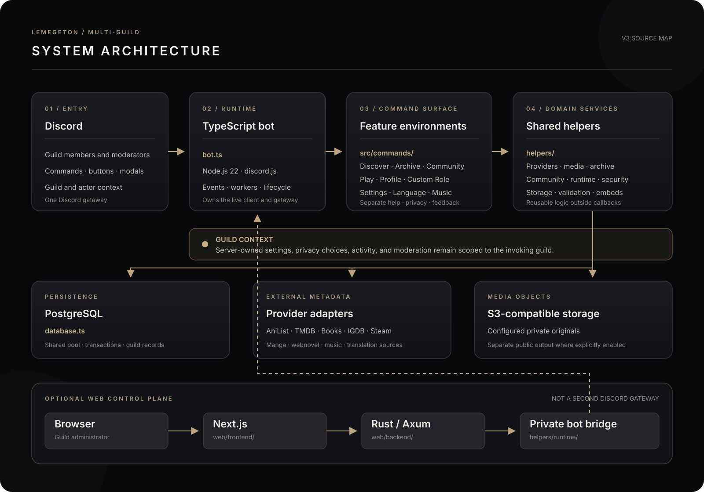

# Architecture

  

This guide describes the current `lemegeton-v3` source tree. The diagram is a committed SVG rather than a Mermaid block, so the same map is available in GitHub, code hosts, and local Markdown viewers without relying on a diagram renderer.

## Execution model

1. **Discord** delivers a guild interaction to the single live discord.js client.
2. **`bot.ts`** owns the gateway, event lifecycle, command registry, background workers, and private bot-side bridge services.
3. **`src/registry.ts`** assembles the registered command environments. Feature commands live in `src/commands/`; standalone commands, utilities, and message integrations have their own directories.
4. **`helpers/`** contains the shared domain services, provider adapters, PostgreSQL-facing operations, storage, validation, security, and presentation logic.
5. **`database.ts`** owns the PostgreSQL pool, schema initialization, queries, and transactions. `helpers/media/media-storage.ts` handles configured S3-compatible media objects.

The optional dashboard is a separate control plane: the Next.js frontend calls the Rust/Axum API, which authenticates the browser and forwards approved operations through the private bridge in the running TypeScript bot. It does not start another Discord gateway.

## Source map

| Path | Responsibility |
|:--|:--|
| `bot.ts` | Discord client, event handlers, lifecycle, background workers, and bridge startup |
| `database.ts` | PostgreSQL pool, schema, queries, and transactions |
| `src/registry.ts` | Command registry and feature registration |
| `src/commands/` | Discover, Archive, Community, Play, Profile, Custom Roles, Settings, Language, and Music |
| `src/standalone/` | Independent help, privacy, feedback, and restricted operator commands |
| `src/utility/` | Invite, timestamp, link conversion, and planned-feature utilities |
| `src/integrations/` | Message-driven AniList and social embed integrations |
| `helpers/archive/` | Archive visibility, access, collections, curation, and moderation |
| `helpers/community/` | Daily activities, rankings, sessions, releases, and delivery |
| `helpers/custom-roles/` | Role lifecycle, validation, icons, picker, and storage |
| `helpers/integration/` | Provider clients, HTTP policy, translation, and public web discovery |
| `helpers/media/` | Relationships, provenance, comparisons, notifications, Atlas rendering, and media storage |
| `helpers/runtime/` | Configuration, Discord state, guild retention, language, dashboard bridge, backups, and diagnostics |
| `helpers/security/` | Cryptographic utilities, consent, and security controls |
| `web/frontend/` | Next.js App Router and React dashboard |
| `web/backend/` | Rust/Axum OAuth, API, sessions, and protected control plane |
| `tests/` | Node test suite for bot, providers, storage, guild boundaries, and dashboard bridge |
| `.github/workflows/` | Bot, dashboard, Rust, container, dependency, code, and repository checks |
| `scripts/start.sh` | Combined bot and dashboard process supervisor |

## Data and guild boundaries

- **Guild-owned state** must be read and written with the invoking guild ID. A shared public metadata record is not a reason to share guild settings, votes, submissions, or moderation authority.
- **Onboarding is a feature gate.** Both the guild's data-retention choice and its language must be configured before normal feature commands and protected dashboard routes are available.
- **Member-data cleanup** remains active after a retention policy is selected. Removing a member or leaving a guild must not be treated as permission to skip the configured cleanup behaviour.
- **Media provenance** remains explicit. Provider-declared links, provider recommendations, local matching, and community-approved relationships are different evidence types.
- **Private media objects** stay private. Public generated output uses a separately configured destination; a convenient URL must not silently change an asset's privacy mode.

## Dashboard boundary

The dashboard uses Discord OAuth and server-side sessions. Protected guild operations must re-check the current Discord user, the bot's presence in the guild, and the user's current Manage Server or Administrator permission. Origin and CSRF checks protect writes. The Rust service forwards only the approved bridge contract to the private TypeScript bot listener.

The browser must not be treated as an authority for guild IDs, permissions, command visibility, or successful synchronization. The live bot and database remain the source of truth.

See [Dashboard](DASHBOARD.md) for the HTTP contract and deployment, [Security audit](SECURITY_AUDIT.md) for source-level findings and residual risks, and [CI](CI.md) for automated and manual verification boundaries.

## Provider and background work

Provider clients are grouped under `helpers/integration/`. The command layer calls those clients through the relevant domain helper; provider-specific response shapes should not leak across unrelated media categories. Missing credentials, provider errors, rate limits, and public-page access challenges remain explicit failure states.

Background schedules are started and stopped with the bot lifecycle. Delivery and retry state belongs to the corresponding community or media service, not to a dashboard process.

## Deployment

- `npm start` runs the compiled TypeScript bot independently.
- The combined `scripts/start.sh` entry point expects the Next.js static export and Rust dashboard binary, then supervises both the dashboard and bot processes.
- Docker and hosted deployment configuration use the same Node.js/Rust runtime contract.
- VPS examples use separate systemd services and an Nginx reverse proxy.

A diagram is a navigational aid, not proof that a feature is configured or a service is deployed. Check the corresponding environment variables, CI result, and live acceptance evidence before making release claims.
