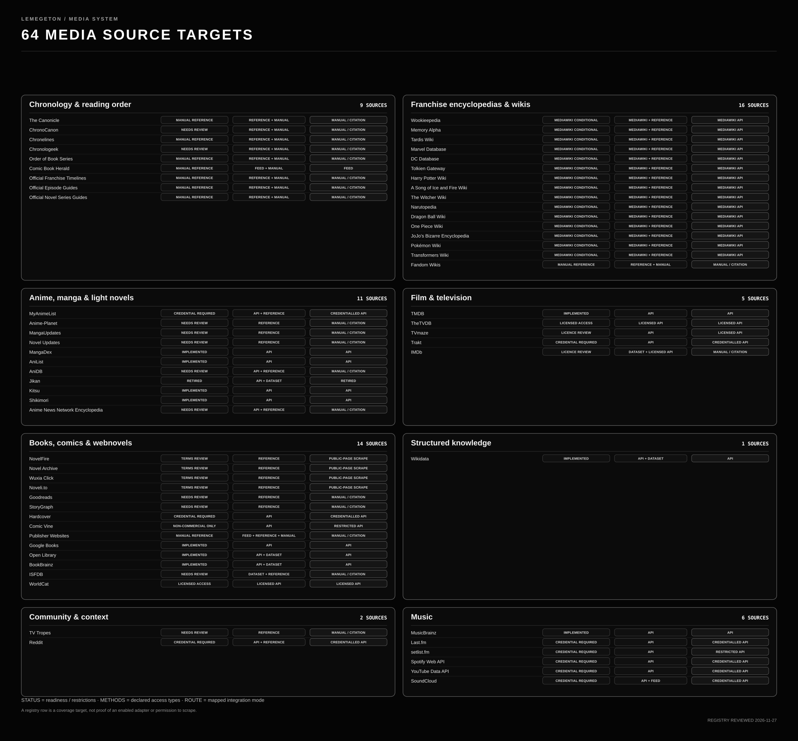
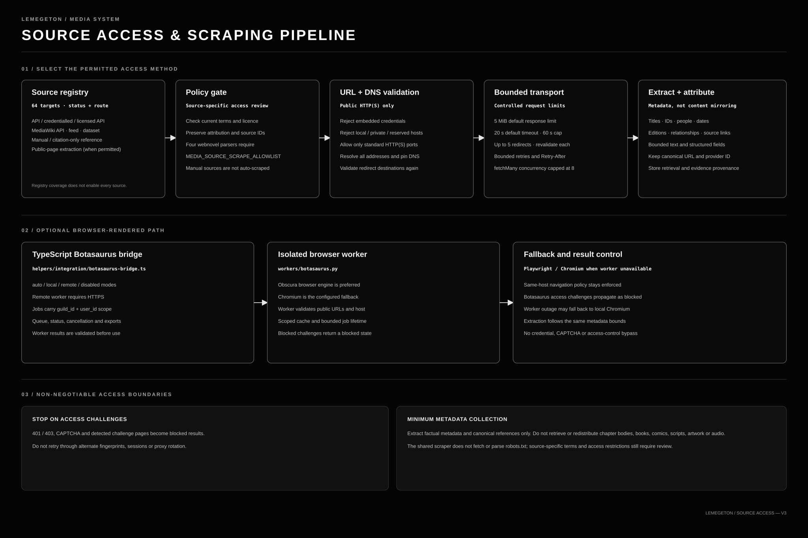
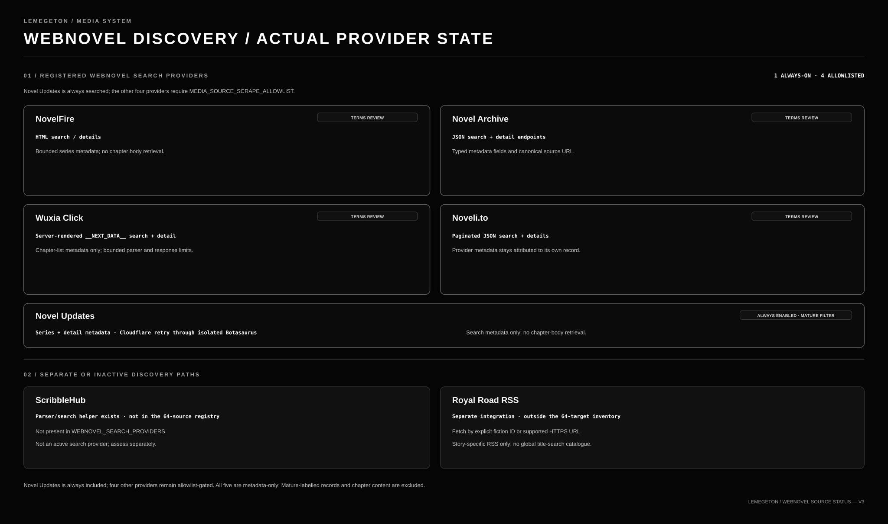
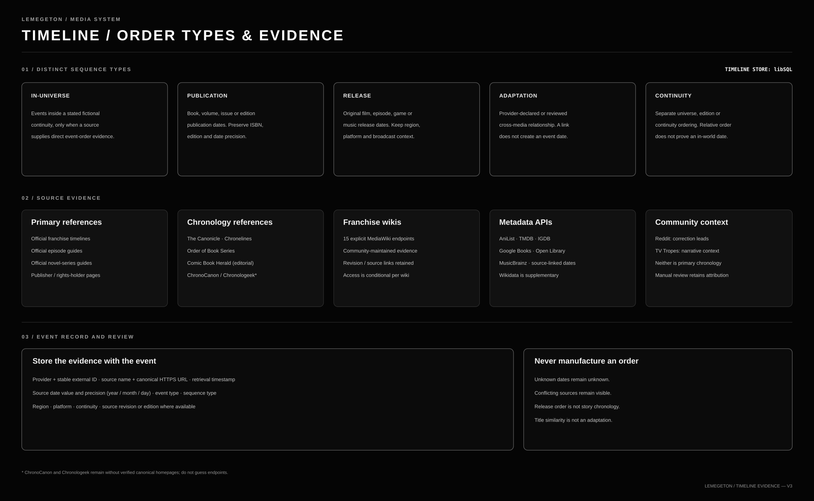
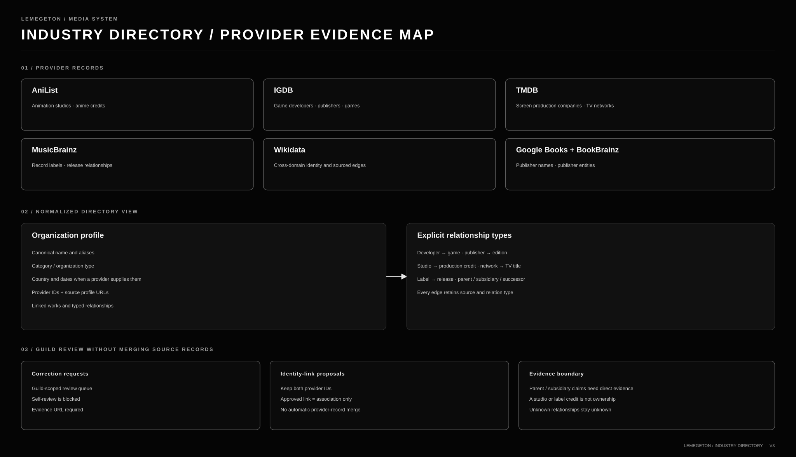
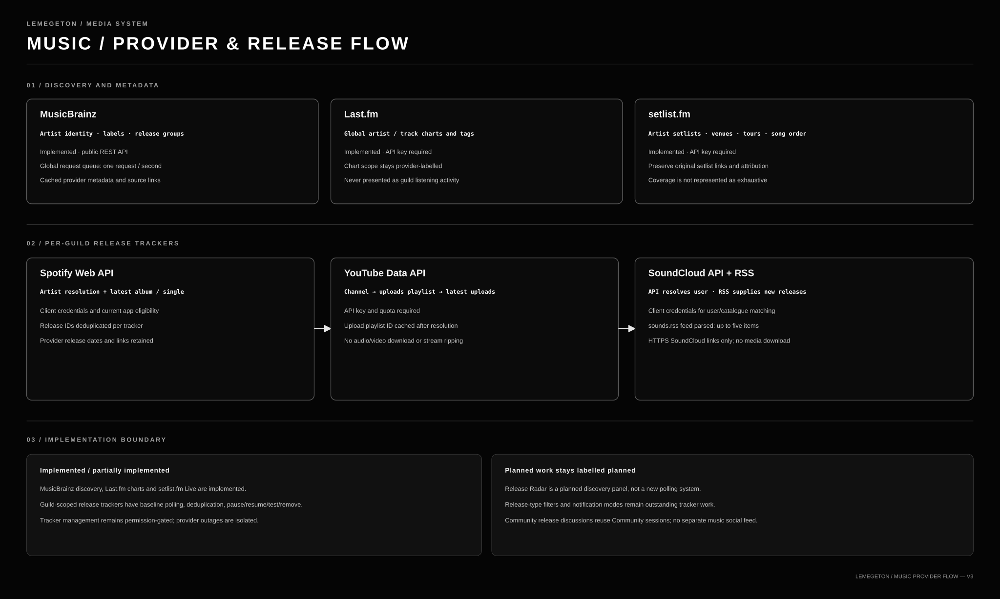
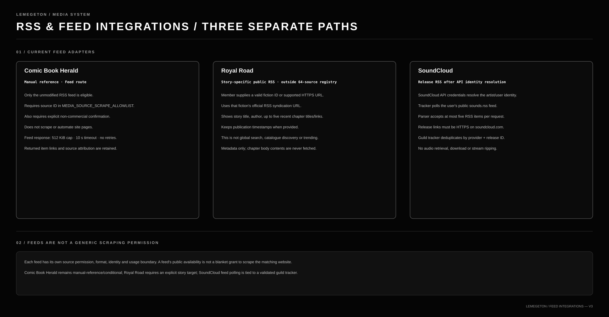

# Media Sources, Scraping & Evidence

Lemegeton's source inventory is broader than its currently enabled provider clients. This guide separates **coverage targets**, **integration routes**, **registry readiness**, and **runtime enablement**. The source registry and explicit integration-mode map are the authority; the diagrams are a visual index of those same records.

**Reviewed:** 2026-11-27  
**Inventory:** 64 unique source targets · 8 categories · 9 integration routes

## Source coverage atlas

  

| Category | Targets |
|:--|--:|
| Chronology and reading order | 9 |
| Franchise encyclopedias and wikis | 16 |
| Anime, manga and light novels | 11 |
| Film and television | 5 |
| Books, comics and webnovels | 14 |
| Structured knowledge | 1 |
| Community and context | 2 |
| Music | 6 |
| **Total** | **64** |

The registry intentionally deduplicates repeated source names from the original Command Expansions inventory. It records source identity, category, acceptable method(s), readiness status, homepage and access notes.

## Reading the status and route fields

The two labels are separate:

- **Registry status** describes readiness or a restriction: implemented, credential-required, licensed-access, license-review, terms-review, mediawiki-conditional, manual-reference, needs-review, restricted-noncommercial or retired.
- **Integration route** describes the evaluated access path: API, credentialed API, licensed API, restricted API, MediaWiki, public-page scraping, feed, manual reference or retired.

An `implemented` status does not mean all provider features are connected to every command. Conversely, a `scrape` route does not mean requests are currently enabled: the four webnovel parsers remain `terms-review` and are disabled unless an operator explicitly adds the corresponding IDs to `MEDIA_SOURCE_SCRAPE_ALLOWLIST`.

**A registry row is not permission to scrape or redistribute content.** Each source still needs its own current access, licence, attribution, rate-limit and content-scope review. Some entries intentionally have no homepage or a manual/citation-only route.

## Source access and extraction pipeline

  

### Shared HTTP and browser extraction

The shared TypeScript transport is `helpers/integration/web-scraper.ts`. It supports bounded public HTTP(S) page and JSON reads, batch fetches, sitemap discovery, structured metadata extraction and a bounded public-site crawl.

The primary protections are part of the actual request path:

- URL validation rejects embedded credentials, local/internal hostnames, private or reserved addresses and non-standard ports.
- DNS answers are checked for public unicast addresses and pinned for the request. Redirect targets are revalidated and DNS-pinned again.
- Response bytes, text extraction, selectors, links, timeout, retries, redirects, concurrency and crawl page counts are bounded.
- Generic 401/403 responses, login/paywall gates, explicit denials, IP/network blocks, and rate limits remain blocked. A detected Cloudflare challenge may use the Botasaurus challenge flow only when that individual scrape explicitly sets `cfBypass: true` and the source-specific review permits it. Other CAPTCHA types remain blocked. The optional Turnstile solver runs only when `CAPTCHA_SOLVER_PROVIDER` is `twocaptcha` or `capsolver` and an API key is configured.
- The shared scraper does **not** fetch or parse `robots.txt`; this does not remove the need to review each source's terms, access restrictions, licence, attribution and permitted reuse.

### Optional browser worker

The browser-rendered path is optional and isolated from the Discord runtime:

- `helpers/integration/botasaurus-bridge.ts` manages local, remote, automatic or disabled worker mode and scopes jobs by guild and user.
- `workers/botasaurus.py` runs the separate browser worker. Obscura is the preferred browser engine; Chromium is the configured fallback.
- The TypeScript scraper can fall back to its local Playwright/Chromium route when the Botasaurus worker is unavailable. That fallback does not solve challenges; Cloudflare handling is available only through the explicit Botasaurus `cfBypass: true` request option.
- A remote worker must use HTTPS. The local worker can use a private loopback/container HTTP endpoint.

#### Opt-in Cloudflare and Turnstile handling

`cfBypass` is false unless an integration sets it for an individual eligible scrape. It is passed to the isolated Botasaurus worker; it is not a global bypass switch. The worker uses these bounded settings:

| Variable | Default | Enforced range |
|:--|--:|:--:|
| `BOTASAURUS_CF_CHALLENGE_WAIT_MS` | `30000` ms | `5000..120000` ms |
| `BOTASAURUS_CF_CHALLENGE_POLL_MS` | `1000` ms | `500..5000` ms |
| `CAPTCHA_SOLVER_TIMEOUT_MS` | `120000` ms | `30000..300000` ms |

`CAPTCHA_SOLVER_PROVIDER` is unset by default, which disables external solving. Set it to `twocaptcha` or `capsolver` and provide `CAPTCHA_SOLVER_API_KEY` to enable the optional Cloudflare Turnstile solver. The selected solver receives the public challenge page URL, Turnstile site key, and operator API credential; its returned token is used transiently by the worker. Do not include sensitive query parameters in challenge URLs, persist solver tokens, or log API keys. Review the selected solver's privacy terms and processing role before enabling it.

This path resolves only an eligible Cloudflare/Turnstile anti-bot challenge. It does not authorize access to authenticated, paywalled, private, or otherwise restricted resources, nor does it override source terms, explicit denials, IP/network blocks, or rate limits. Unsupported or unresolved challenges remain blocked.

The optional Python worker is a browser service only. The primary Lemegeton bot runtime remains TypeScript/Node.js.

## Webnovel discovery: active, gated and inactive code paths

  

### Four registered metadata parsers

The `WEBNOVEL_SEARCH_PROVIDERS` array currently contains:

| Provider | Parser route | Registry status |
|:--|:--|:--|
| NovelFire | HTML search/details and JSON chapter metadata | `terms-review` |
| Novel Archive | JSON search and details | `terms-review` |
| Wuxia Click | Server-rendered `__NEXT_DATA__` search/details | `terms-review` |
| Noveli.to | Paginated JSON search/details | `terms-review` |

These providers are disabled by default. Discovery requests only providers whose source IDs are explicitly present in `MEDIA_SOURCE_SCRAPE_ALLOWLIST`. The current scope is metadata and canonical source links only; chapter contents are not retrieved or redistributed.

### Related code that is not active discovery

- **Novel Updates:** a parser and search helper exist, but the registry status is `needs-review` and Novel Updates is not in `WEBNOVEL_SEARCH_PROVIDERS`.
- **ScribbleHub:** parser/search helper code exists, but ScribbleHub is not one of the 64 registry entries and is not in `WEBNOVEL_SEARCH_PROVIDERS`.
- **Royal Road:** a separate integration reads the public RSS feed for an explicitly supplied fiction ID or supported URL. It is story-specific, not a global search or trending catalogue.

Do not describe any of these three paths as active webnovel title-search providers.

## Timeline evidence and order types

  

The stored sequence types are `in-universe`, `publication`, `release`, `adaptation` and `continuity`. They are not interchangeable:

- An episode's air date or a film's release date is **release order**, not an in-world event date.
- A book's publication date is not its recommended reading order or fictional chronology.
- An adaptation relationship links works; it does not establish a dated event sequence.
- A wiki revision or fan chronology is supporting evidence, not automatically primary canon.
- If the source does not provide a date or sequence, leave it unknown.

Timeline events retain provider identity, source URL, date precision, region, platform, continuity and retrieval metadata. If sources disagree, preserve the conflict or use a documented preference for the relevant event type; do not invent a date or silently average values.

### Current Timeline integration surface

The current Timeline search adapters include AniList (anime/manga/light novels), TMDB (film/TV), IGDB (games), Google Books and Open Library (books), and MusicBrainz (artists). Franchise Wiki search uses the individually enabled MediaWiki sources; chronology references require the operator allowlist; Wikidata is supplementary and its undated relation edges are not in-world dates.

The source inventory lists additional targets for evaluation and future coverage. It is not a claim that every target already provides event-level chronology.

## Industry directory sources

  

The current Industry directory maps provider records to supported organization types:

| Provider | Current use |
|:--|:--|
| AniList | Animation studios and associated anime |
| IGDB | Game companies, developer/publisher roles and game records |
| TMDB | Screen production companies and TV networks |
| MusicBrainz | Music labels and release relationships |
| Wikidata | Sourced cross-domain organization relationships and enrichment |
| Google Books / BookBrainz | Publisher strings and publisher entities |

Provider IDs stay distinct. Similar company names do not automatically merge records. Parent/subsidiary, developer/publisher, production, network, label, publisher and successor relationships retain their source and type. Guild correction suggestions and proposed cross-provider identity links use a Manage Server review queue; approved associations do not rewrite or merge provider records.

Known remaining Industry gaps include global provider-identity reconciliation, broader label search beyond existing MusicBrainz records, organization founding/renaming/successor timelines, primary-source evidence for parent/subsidiary changes and verified ownership/merger event history.

## Additional v3 integrations outside the 64-target registry

The 64-entry inventory is scoped to the Timeline and Industry source research list. Other existing integrations remain relevant to cross-media discovery:

- **IGDB and Steam** provide game catalogue and Steam features.
- **Crossref** supports ISBN-filtered bibliographic matching through its public works endpoint.
- **Royal Road** supplies story-specific RSS metadata as described above.
- **MusicDiscovery** uses MusicBrainz and optional credentialed services such as Last.fm, setlist.fm, Spotify, YouTube Data API and SoundCloud.

These integrations keep their own provider identity, limits and provenance. They are not silently folded into the 64-entry research inventory.

## Music providers and release trackers

  

The Music feature has two related but distinct integrations:

| Provider | Current use | Access boundary |
|:--|:--|:--|
| MusicBrainz | Artist identity, labels, release groups and discography | Public API; shared global queue keeps requests at approximately one per second. |
| Last.fm | Global artist/track charts and artist tags | API key required; label charts as provider-wide, not guild listening activity. |
| setlist.fm | Artist setlists, tour, venue, date and song order | API key required; preserve original setlist attribution. |
| Spotify Web API | Artist identity and latest album/single metadata | Client credentials and current app-mode eligibility required. |
| YouTube Data API | Channel identity, uploads playlist and video metadata | API key and quota required; cache the uploads playlist ID and poll playlist items. |
| SoundCloud | Artist identity and tracker release updates | API credentials resolve the user; its public RSS feed supplies release metadata. |

MusicBrainz discovery, Last.fm charts and setlist.fm Live are implemented. The per-guild tracker has its baseline polling and management controls; release-type filters and notification modes remain outstanding. Release Radar and Community release discussions are planned, not current functionality.

No integration downloads audio or video. Trackers are guild-owned and do not become personal listening histories.

## RSS and feed integration paths

  

| Feed | Purpose | Gate / limitation |
|:--|:--|:--|
| Comic Book Herald | Chronology and editorial reading-guide references | Manual-reference source; only unmodified RSS is eligible, with the source allowlisted and explicit non-commercial confirmation. No site-page scraping. |
| Royal Road | Metadata for a specific fiction selected by ID or supported URL | Story-specific RSS only; not global title search or trending discovery. |
| SoundCloud | Latest releases for a tracked artist | API resolves the artist/user first; the public RSS feed is used for release updates. Up to five items are parsed. |

These feed paths are separate from the four allowlisted webnovel metadata parsers. They keep each source's attribution, request scope and data boundaries.

## Canonical implementation references

| Purpose | Current source |
|:--|:--|
| 64-target inventory and registry status | `helpers/media/media-source-registry.ts` |
| One integration route for every inventory source | `helpers/integration/media-source-clients.ts` — `MEDIA_SOURCE_INTEGRATION_MODES` |
| Coverage and restricted-state tests | `tests/media-source-registry.test.ts` |
| Fifteen explicit MediaWiki endpoints | `helpers/integration/mediawiki.ts` |
| Shared HTTP/JSON and browser extraction | `helpers/integration/web-scraper.ts` |
| Botasaurus bridge and scoped job client | `helpers/integration/botasaurus-bridge.ts` |
| Isolated browser worker | `workers/botasaurus.py` |
| Webnovel parser helpers and active provider array | `helpers/integration/webnovel-discovery.ts` |
| Royal Road story RSS | `helpers/integration/royal-road.ts` |
| Crossref bibliographic matching | `helpers/integration/crossref.ts` |
| Timeline sequence persistence | `helpers/media/timeline-store.ts` |
| Industry organization directory | `helpers/media/industry-directory.ts` |
| Full source intent and access decisions | [Command Expansions — Source inventory and integration strategy](../Command%20Expansions.md) |
