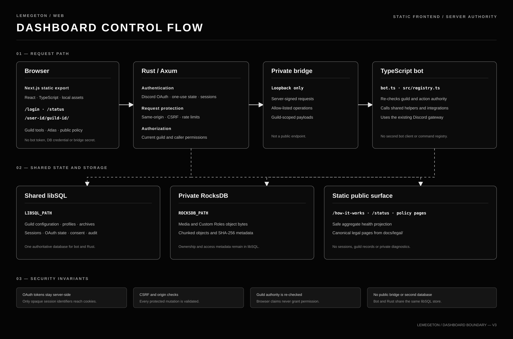
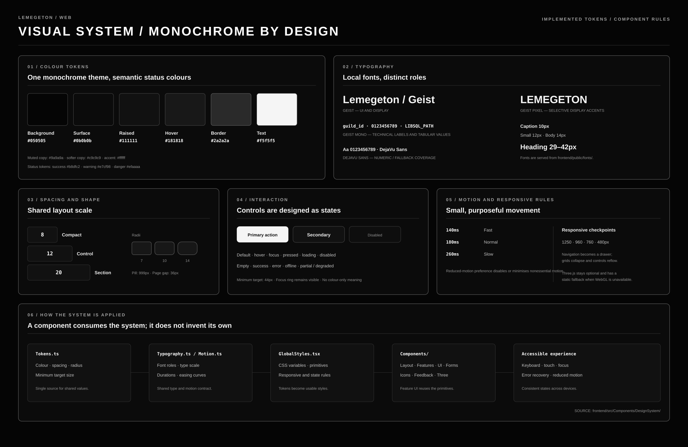
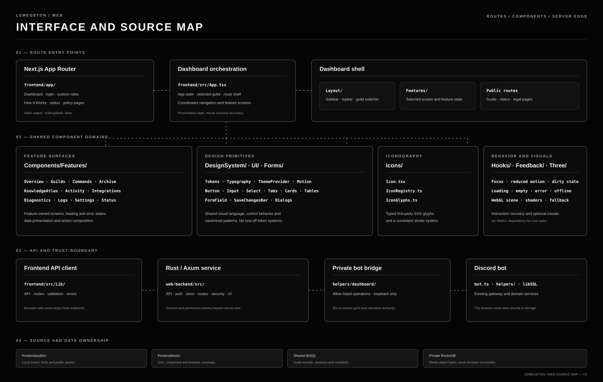

# LEMEGETON / WEB

  

  <strong>THE OPTIONAL CONTROL PLANE</strong>

  NEXT.JS · REACT · TYPESCRIPT · THREE.JS · RUST · AXUM

  <a href="../README.md">Repository</a> ·
  <a href="../docs/ARCHITECTURE.md">Architecture</a> ·
  <a href="../docs/DASHBOARD.md">Deployment</a> ·
  <a href="PERFORMANCE_CHECKLIST.md">Performance</a> ·
  <a href="../CONTRIBUTING.md">Contributing</a>

---

## 01 / ROLE IN THE SYSTEM

The web application is Lemegeton's optional server-management surface. It gives authorised users a browser interface for supported guild settings, command access, archives, diagnostics and the Knowledge Atlas. Public routes provide the How It Works guide, service status and policy pages.

Discord remains the primary member interface. The dashboard is not a second Discord client, does not create another gateway connection and cannot replace bot-side permission checks.

  

### Request and trust flow

1. **Browser:** the Next.js frontend is statically exported. It contains presentation code and public assets, not bot credentials or database access.
2. **Rust/Axum:** serves the static export from the same origin and handles Discord OAuth, sessions, CSRF/origin validation, rate limits and guild authorization.
3. **Private bridge:** Rust forwards only approved operations through the bot's loopback bridge. The bot checks the current guild, caller and command/record permissions again.
4. **Shared storage:** the bot and Rust service use the same libSQL database and Rust storage crate. RocksDB holds private object bytes; the browser never accesses either store directly.

Next.js exports non-root pages as internal `route.html` files because `trailingSlash` is disabled. Rust maps those build artifacts to extensionless public paths and handles legacy `.html`, trailing-slash and `route/index.html` variants. The authenticated dashboard keeps the `/user-id/guild-id/` path while its internal sections change.

---

## 02 / VISUAL DESIGN SYSTEM

The web interface follows one deliberately restrained visual language: monochrome surfaces, clear type hierarchy, fine borders, compact metadata and purposeful motion. The source of truth is `frontend/src/Components/DesignSystem/`.

  

### Colour and theme

The `ThemeProvider` currently exposes **monochrome only**. Components consume the shared CSS variables generated from `Tokens.ts`; new feature styles should reuse those variables instead of introducing one-off palettes.

| Token | Value | Use |
|:--|:--|:--|
| Background | `#050505` | Page canvas |
| Surface | `#0b0b0b` | Cards and panels |
| Raised surface | `#111111` | Raised controls and nested surfaces |
| Hover surface | `#181818` | Hovered surfaces |
| Border | `#2a2a2a` | Main boundaries |
| Primary text | `#f5f5f5` | Headings and primary content |
| Muted text | `#9a9a9a` | Supporting copy |
| Status | Tokenised success, warning and danger | State communication; never colour alone |

### Typography and local assets

Fonts are served from `frontend/public/fonts/`; the dashboard does not need a remote font request.

- **Geist** is the main interface and display face.
- **Geist Mono** is used for technical labels and tabular values.
- **DejaVu Sans** provides numeric and fallback coverage.
- **Geist Pixel** supplies restrained pixel/Braille-adjacent accents, not long-form body text.

The shared scale is caption 10px, small 12px, body 14px and responsive headings from 29px to 42px. Use the typography exports and CSS variables rather than hard-coding a new type scale.

### Layout, icons and controls

The token set defines 8px compact spacing, 12px control spacing, 20px section spacing and 36px page spacing. Standard corner radii are 7px, 10px and 14px, with a pill shape reserved for status-like elements. The minimum interactive target is 44px.

Icons are first-party inline SVGs from `Components/Icons/`. Use the typed `Icon` component and its registry; do not introduce emoji glyphs or unrelated icon packs into dashboard UI.

### Motion, responsive behavior and WebGL

Shared motion durations are 140ms, 180ms and 260ms. Motion should clarify focus, activation or state change rather than decorate every element. The interface respects `prefers-reduced-motion`.

The responsive system has explicit layouts for desktop, tablet and narrow mobile widths. The sidebar becomes a mobile navigation drawer, content grids collapse, and controls retain usable touch targets. Verify at narrow widths rather than assuming desktop layout will scale down correctly.

Three.js/React Three Fiber visuals are optional enhancements. They are client-side, are not required for dashboard operation, and must retain the static fallback when WebGL is unavailable or motion should be reduced.

### Practical design rules

- Use the existing tokens for colour, spacing, radii, type and motion.
- Keep the interface monochrome; status colours are semantic, not decorative accents.
- Keep content hierarchy clear and use monospace only for technical values.
- Provide visible focus, disabled, pressed, loading, empty, success and error states where they apply.
- Prefer local feedback over page-wide blocking states.
- Keep every protected action server-authorised; hiding a control is never a permission check.
- Avoid remote fonts, analytics trackers and unnecessary third-party browser requests.

---

## 03 / INTERFACE AND SOURCE MAP

The interface is separated by responsibility. Routes own page entry points; the dashboard shell owns navigation and selected-guild context; feature components own their screens; shared design primitives remain in the design-system and UI folders.

  

| Location | Responsibility |
|:--|:--|
| `frontend/app/` | Next.js route entry points: dashboard, login, Custom Roles, How It Works, status and policy pages. |
| `frontend/src/App.tsx` | Dashboard orchestration and selected application state. |
| `Components/Features/` | Overview, guilds, commands, archives, activity/audit, integrations, diagnostics, Atlas, status and settings. |
| `Components/Layout/` | Dashboard shell, sidebar, topbar, mobile navigation and guild switcher. |
| `Components/DesignSystem/` | Tokens, typography, theme provider, global styles, responsive rules and motion. |
| `Components/UI/` · `Components/Forms/` | Shared controls, fields, save/reset flows and form sections. |
| `Components/Icons/` | Typed icon component, registry and SVG glyphs. |
| `Components/Feedback/` · `Components/Hooks/` | Loading, empty, error, success and offline states; focus and interaction hooks. |
| `Components/Three/` | Optional WebGL scene, shader materials, scene lifecycle and fallback. |
| `frontend/src/Lib/` · `Types/` | API client, route helpers, validation and dashboard contracts. |
| `frontend/tests/` | Component, unit and Playwright browser tests. |
| `backend/src/` | Axum routes, API handlers, auth/session lifecycle, security, shared store and static UI serving. |

Bot-side dashboard services remain under `helpers/dashboard/`; the private bridge is started by `bot.ts`. It is not a separate command runtime.

---

## 04 / PAGES AND POLICY ROUTES

| Public path | Purpose |
|:--|:--|
| `/` | Private dashboard entry |
| `/login` | Discord sign-in |
| `/custom-roles` | Custom Role Studio |
| `/how-it-works` | Public system and data-flow guide |
| `/status` | Safe aggregate service health |
| `/privacy-policy` | Privacy Policy |
| `/terms-of-service` | Terms of Service |
| `/community-guidelines` | Community Guidelines |
| `/copyright-complaints` | Copyright and content complaints |
| `/dmca` | DMCA and Copyright Policy |
| `/thank-you` | Opens the appreciation dialog through the dashboard redirect |

Short policy URLs permanently redirect to their canonical extensionless routes: `/privacy`, `/terms`, `/tos`, `/community`, `/guidelines` and `/copyright`. `/github` opens the repository and `/issues` opens its issue tracker. Legacy trailing-slash, `.html` and `/index.html` paths redirect to canonical paths. The generated `status.html` is a build artifact, not the public status URL.

The hosted policy pages use the Markdown sources in `docs/legal/`; do not maintain a second copy of policy text in the frontend.

---

## 05 / DASHBOARD CAPABILITIES

| Area | What it provides |
|:--|:--|
| Guild overview | Select an accessible server and view its supported summary. |
| Command configuration | Inspect registered feature commands and configure supported per-guild settings. |
| Command access | Manage role/channel rules; the bot rechecks those rules when commands and existing interactive controls run. |
| Knowledge Atlas | Explore bounded media relationships, provenance and supported graph exports. |
| Activity and audit | View available activity summaries and guild-scoped audit history. |
| Integrations and diagnostics | Inspect supported integration state and protected runtime diagnostics. |
| Public status | Safe aggregate component health without guild data, private logs or credentials. |
| Legal and consent | Review policy pages and manage supported consent preferences. |

Dashboard section changes are local UI state: switching between Overview, Commands, Archive and other sections keeps the current `/user-id/guild-id/` path. Selecting a different server updates the selected guild path.

---

## 06 / SECURITY AND DATA BOUNDARIES

**Authentication.** Discord OAuth2 is handled by Rust. OAuth state is short-lived, stored server-side and consumed once. Session cookies contain an opaque identifier; Discord tokens remain server-side.

**Request protection.** Mutations require trusted same-origin requests and CSRF validation. HTTPS deployments use host-only secure cookies with `HttpOnly` and `SameSite=Lax`.

**Guild authorization.** Protected actions re-check the signed-in member's current guild membership and Manage Server or Administrator permission. Bot-wide diagnostics and runtime logs are restricted to bot moderators. Browser-supplied guild IDs and permission claims are not authority.

**Private bridge.** Rust forwards only allowed operations through a loopback-only bot bridge. Requests use server-side credentials, and the bot repeats guild, command and record-level validation.

**Storage.** The bot and Rust service share `LIBSQL_PATH` through the common Rust storage crate. RocksDB stores private media and Custom Role object bytes; ownership and authorization metadata remain in libSQL. The browser has no direct database or object-store access.

**Browser privacy.** The dashboard uses essential authentication/consent cookies and an optional remember-selected-server preference, disabled by default. It does not use analytics or advertising trackers. Cookie preferences are distinct from required policy acceptance.

The dashboard does not expose arbitrary SQL, shell access, unrestricted extension execution or bot-token management.

---

## 07 / RUN AND VERIFY

Run commands from the repository root.

~~~bash
npm install --prefix web/frontend
npm run typecheck --prefix web/frontend
npm run test:unit --prefix web/frontend
npm run build --prefix web/frontend
npm run test:e2e --prefix web/frontend

cargo fmt --manifest-path web/backend/Cargo.toml -- --check
cargo test --manifest-path web/backend/Cargo.toml
cargo clippy --manifest-path web/backend/Cargo.toml --all-targets --all-features -- -D warnings
~~~

The frontend build exports static files to `web/frontend/out/`; Rust serves those assets. Do not start a separate production Next.js server alongside the Rust dashboard service.

Unit tests and local builds do not verify the registered Discord OAuth application, live guild permissions, provider credentials, production storage paths, backup/restore or reverse-proxy configuration. Those require acceptance in the target environment. Browser E2E tests should be run and reported separately from unit tests.

---

## 08 / RELATED DOCUMENTATION

- [Performance checklist and remaining work](PERFORMANCE_CHECKLIST.md)
- [Dashboard & deployment](../docs/DASHBOARD.md)
- [Architecture](../docs/ARCHITECTURE.md)
- [Data backups](../docs/DATA_BACKUPS.md)
- [Privacy requests](../docs/legal/DATA_DELETION_AND_PRIVACY_REQUESTS.md)
- [Data retention schedule](../docs/legal/DATA_RETENTION_SCHEDULE.md)
- [Security policy](../docs/legal/SECURITY.md)
- [Legal and policy index](../docs/legal/README.md)
- [Contributing](../CONTRIBUTING.md)
